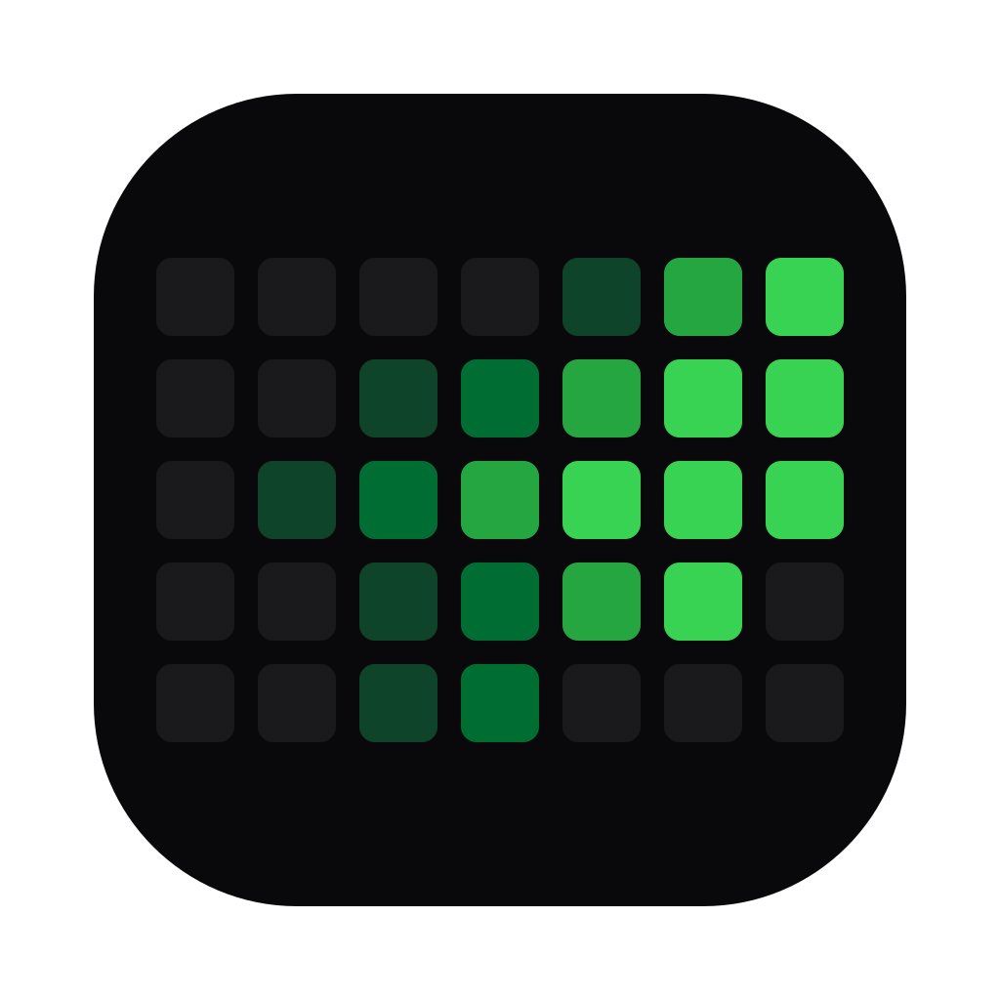

<div align="center">



# ContribKit · App

**The Android app: render your contribution calendar, customize it, and pin it to your home screen as a widget. The same Flutter code builds for iOS, but only Android is released.**

[](https://github.com/fbuireu/contribkit/actions/workflows/ci.yml)
[](https://codecov.io/gh/fbuireu/contribkit)

**[Project overview](../README.md)** · **[Google Play](https://play.google.com/store/apps/details?id=com.fbuireu.contribkit)** · **App Store (soon)** · **[Web docs](../web/README.md)**

</div>

---

## Table of Contents

- [Features](#features)
- [Stack](#stack)
- [Architecture](#architecture)
- [Development](#development)
- [Home-Screen Widgets](#home-screen-widgets)
- [Tip Jar](#tip-jar)
- [Releases](#releases)

---

## Features

- 📱 **Android, on Google Play:** one Flutter codebase that also builds for iOS, which is not released yet; the Home Screen Widgets and their background refresh are Android only
- 🎨 **Every palette and shape:** palettes are loaded from [`shared/`](../shared); the shapes are a hardcoded `CellShape` enum, because nothing in Dart reads `shapes.json` ([ADR 0002](../docs/adr/0002-shared-design-tokens-mirrored-into-the-flutter-bundle.md))
- 🧿 **Home-screen widgets (Android):** small (streak counter) and medium (grid, streak and total)
- 🔋 **Daily background refresh (Android):** WorkManager fetches once a day when there is a network, easy on the battery, and the app rewrites the widget after every fetch and every Palette or Cell Shape change
- 📤 **Export & share:** PNG, SVG, or Markdown straight into the system share sheet
- 🔓 **No login:** just a username, and only public contribution data

---

## Stack

| Concern             | Choice                                                              |
| ------------------- | -------------------------------------------------------------------- |
| Framework           | Flutter (stable channel)                                            |
| State management    | Riverpod (`riverpod_annotation` codegen)                            |
| Models              | freezed + json_serializable                                         |
| Persistence         | Hive (cache + settings)                                             |
| Widgets & refresh   | `home_widget` + `workmanager` (Android)                             |
| Networking          | `http`, straight to GitHub's public page and to `contribkit.app/api/contact` |
| UI primitives       | `shadcn_ui` (wrapped in `AppXxx` widgets) + `flutter_animate` + `google_fonts` |
| Tips                | RevenueCat (`purchases_flutter`)                                    |
| Diagnostic Reports  | Sentry (`sentry_flutter`), on unless turned off in the Privacy sheet |
| Usage Events        | PostHog (`posthog_flutter`), off until turned on in the Privacy sheet |

---

## Architecture

Same DDD-ish layering as the web. The rules are in [`CODING_STANDARDS.md`](../CODING_STANDARDS.md), and each layer has a colocated `AGENTS.md` for whoever works in it:

| Layer                                                    | Role                                                                  |
| --------------------------------------------------------- | --------------------------------------------------------------------- |
| **[domain](lib/domain/AGENTS.md)**                       | Pure Dart business core: entities, value objects, typed `Failure`s    |
| **[application](lib/application/AGENTS.md)**             | One class per use case, dependencies via constructor                  |
| **[infrastructure](lib/infrastructure/AGENTS.md)**       | GitHub client, Hive persistence, export implementations               |
| **[infrastructure/github/dtos](lib/infrastructure/github/dtos/AGENTS.md)** | JSON DTOs, converted to entities at the boundary    |
| **[ui](lib/ui/AGENTS.md)**                               | Widgets + Riverpod providers: the only layer that knows Riverpod      |
| **[ui/di](lib/ui/di/AGENTS.md)**                         | All dependency wiring                                                 |
| **[ui/theme](lib/ui/theme/AGENTS.md)**                   | Design tokens and semantic colors                                     |

---

## Development

```bash
flutter pub get
```

Install the Flutter that `environment.flutter` pins in [`pubspec.yaml`](./pubspec.yaml): a different one blocks `pub get` and codegen.

**`dart-defines.json` is gitignored, so create it before the first run.** The app reads six build-time keys, and every one may be empty: an empty value only turns its feature off.

```bash
cat > dart-defines.json <<'JSON'
{
  "REVENUECAT_KEY": "",
  "SENTRY_DSN": "",
  "POSTHOG_PROJECT_TOKEN": "",
  "TELEMETRY_ENVIRONMENT": "development",
  "APP_RELEASE": ""
}
JSON
```

| Key | What it turns on | Empty or absent |
| --- | --- | --- |
| `REVENUECAT_KEY` | the Tip Jar, through RevenueCat | the Tip Jar renders as unavailable |
| `SENTRY_DSN` | Diagnostic Reports | none is sent |
| `POSTHOG_PROJECT_TOKEN` | Usage Events | none is sent |
| `POSTHOG_HOST` | where Usage Events go | the EU host |
| `TELEMETRY_ENVIRONMENT` | the environment a Diagnostic Report is filed under | `development` |
| `APP_RELEASE` | the release a Diagnostic Report is filed under | none |

`dart-defines.prod.json` is the same file with production's RevenueCat key where `dart-defines.json` has the sandbox one, and `TELEMETRY_ENVIRONMENT` set to `production`; there are no build flavors, so the file you pass is the stage ([ADR 0022](../docs/adr/0022-the-app-has-no-build-flavors-and-the-stage-is-a-dart-defines-file.md)). CI writes its own `dart-defines.json` at release time and never reads yours.

| Command                                                      | Action                              |
| ------------------------------------------------------------ | ----------------------------------- |
| `flutter run --dart-define-from-file=dart-defines.json`      | Run locally                         |
| `dart run build_runner watch`                                | Watch codegen (riverpod, freezed)   |
| `flutter test --coverage`                                    | Run tests                           |
| `dart run tool/check_coverage.dart`                          | The coverage floor CI and `pre-push` enforce, over the last `--coverage` run |
| `dart analyze --fatal-infos`                                 | Static analysis, as CI and the hooks run it: an info fails it |

Git hooks are repo-wide. See **[Monorepo Development](../README.md#monorepo-development)**.

---

## Home-Screen Widgets

**Android only.** [`app/ios`](./ios) carries the `Runner` and `RunnerTests` targets and nothing else. There is no WidgetKit extension, so an iOS install has no home-screen widget. Two sizes ship:

| Size            | Provider                        | Shows                                                     |
| --------------- | ------------------------------- | --------------------------------------------------------- |
| Small (80×40dp) | `ContribKitSmallWidgetProvider` | Streak counter                                            |
| Medium (250×110dp) | `ContribKitWidgetProvider`   | Username, streak badge, the grid image and the year total |

Widgets render with whatever palette you set in the app. The app rewrites them after every calendar it fetches and every Palette or Cell Shape change, and WorkManager refreshes them once a day in the background, when there is a network, so the grid stays current without draining the battery. A refresh that fails for the world's reasons (no network, a rate limit) is retried later; one that fails for a defect is reported to Sentry. The [Mobile App](https://github.com/fbuireu/contribKit/wiki/Mobile-App#keeping-the-home-screen-widget-current) wiki page follows both writers end to end, and says why iOS has neither.

---

## Tip Jar

A simple **Tip Jar** ($1 / $5 / $10) built with the RevenueCat SDK and a custom Flutter UI (no RevenueCat Paywall builder, and `purchases_ui_flutter` is not a dependency: the docs contract asserts it stays out). Tips are one-time, unlock nothing, and the app is fully functional without them.

---

## Releases

Driven by [`release-app.yml`](../.github/workflows/release-app.yml), dispatched by hand from `main` with a Google Play track. **Android only**: no workflow builds or ships iOS.

- **Versioning:** semantic-release bumps `pubspec.yaml`, writes the changelog and tags `app-vX.Y.Z`. With nothing to release, nothing is delivered.
- **Build:** from that tag, never from `main`. The release **fails when `REVENUECAT_KEY` is missing**, because the app would ship with its Tip Jar unavailable. CI writes its own `dart-defines.json` with five of the keys above (all but `POSTHOG_HOST`) from the GitHub Environment's secrets, then builds a release AAB with `--obfuscate --split-debug-info`, signed with the upload keystore decoded from secrets at build time and minified with R8 (code + resource shrinking).
- **Symbols:** the debug symbols go to Sentry, and the release **fails when `SENTRY_AUTH_TOKEN` is missing**, because an obfuscated build without them makes every Diagnostic Report unreadable.
- **Changelogs:** release notes are written to `android/fastlane/metadata/android/en-US/changelogs`, from the newest `CHANGELOG.md` section, clamped to Play's 500 characters.
- **Publish:** fastlane uploads to the selected **Google Play track**, with up to three attempts; `production` uses the `app-production` GitHub Environment, anything else uses `app-development` (internal track + RevenueCat sandbox). Every upload is `release_status: "completed"`, so **a production release rolls out to 100% at once**.
- **Clean up:** the keystore, the signing config, the service account and `dart-defines.json` are deleted when the job ends, whatever happened.
- **When delivery fails** after the tag exists, a new dispatch finds nothing to release: re-run the failed job on the same run. The [CI/CD wiki page](https://github.com/fbuireu/contribKit/wiki/CI-CD) has the full flow, its secrets and that recovery.

See the **[root README](../README.md#monorepo-development)** for the environments naming convention shared with the web.
