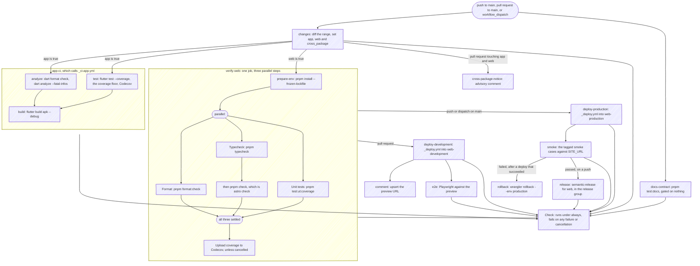
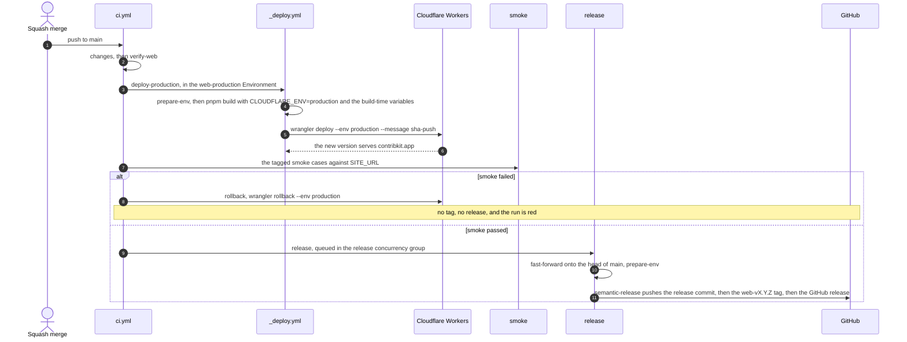
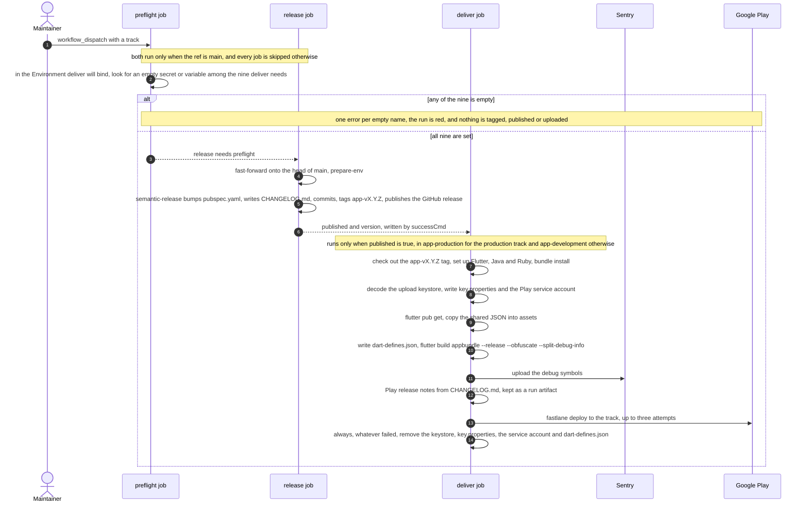
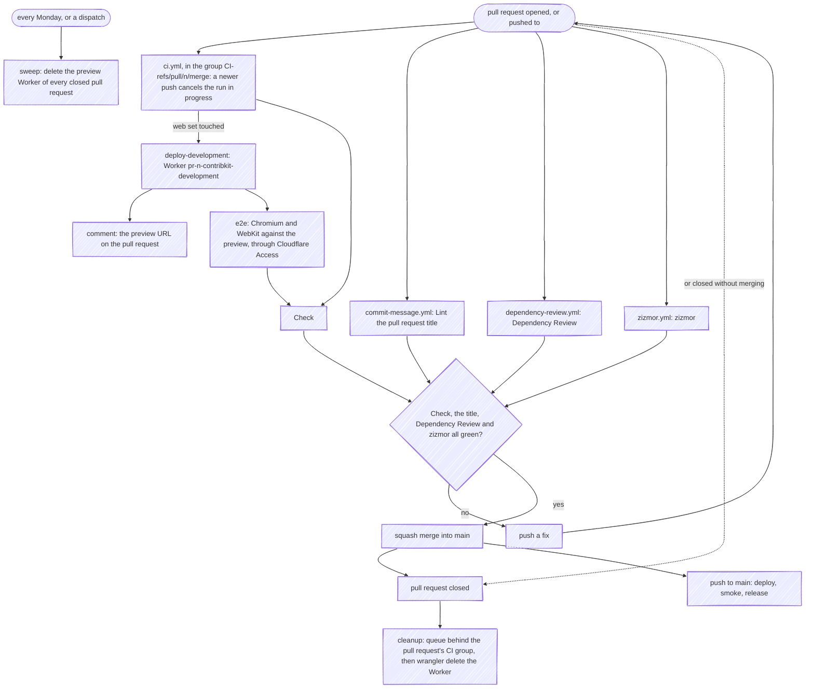

# CI/CD

CI is one workflow with **no path filter**, and a `changes` job that gates each per-component job with `if:`, so an app change never triggers a web build and vice versa. Each component is linted, tested, built, versioned with semantic-release, and shipped: the web to Cloudflare Workers on every qualifying push to `main`, the app to Google Play when the maintainer dispatches a release.

> **Path filters used to be where guards died here.** The CI was two workflows filtered by `paths:`, so every
> guard had to be paired with the question of which filter carried the files it read, and that was answered wrong
> three times: the app side, the preview-Worker cleanup, and `scripts/**` plus the root [`package.json`](https://github.com/fbuireu/contribKit/blob/main/package.json), whose
> comments and version pins the contract asserts while no workflow watched them. A fourth copy of the filter had
> drifted and left preview Workers alive. There is one [`ci.yml`](https://github.com/fbuireu/contribKit/blob/main/.github/workflows/ci.yml) now with **no path filter**, and a `changes` job
> that gates jobs with `if:` instead. Workflows live in [`.github/workflows/`](https://github.com/fbuireu/contribKit/tree/main/.github/workflows).

---

## Workflows

| Workflow | Triggers on | Does |
|----------|-------------|------|
| `ci.yml` | push to `main`, pull request to `main`, and manual dispatch (`workflow_dispatch`, with an optional `reason` shown as the run name) | the whole pipeline below: `changes`, `docs-contract`, App CI, `verify-web`, both deploys, the preview comment and E2E, the production smoke run, the rollback, the web release, the cross-package notice, and the `Check` aggregate. A dispatch redeploys production and the smoke run behind it and cuts no release |
| [`_ci-app.yml`](https://github.com/fbuireu/contribKit/blob/main/.github/workflows/_ci-app.yml) | reusable, called by `ci.yml`'s `app-ci` job | the Flutter half: `analyze`, `test` with the coverage floor, and a debug APK `build`. Its jobs show as `App / Analyze`, `App / Test`, `App / Build`, and none of them can be a required check: see [`Check`](#check) |
| [`_deploy.yml`](https://github.com/fbuireu/contribKit/blob/main/.github/workflows/_deploy.yml) | reusable, called by both deploy jobs | one web deploy: takes the GitHub Environment (`web-production` / `web-development`), derives `CLOUDFLARE_ENV` from it by stripping the `<component>-` prefix, builds, and runs `wrangler deploy` |
| [`release-app.yml`](https://github.com/fbuireu/contribKit/blob/main/.github/workflows/release-app.yml) | manual dispatch with a `track` input (`internal` / `alpha` / `beta` / `production`), from `main` only | a check that every secret and variable the delivery needs is set, then semantic-release for the app, then the signed AAB to the chosen Google Play track. Android only: there is no iOS lane |
| [`cleanup-development.yml`](https://github.com/fbuireu/contribKit/blob/main/.github/workflows/cleanup-development.yml) | pull request closed; every Monday at 03:00 UTC; manual dispatch | `cleanup` deletes the closed pull request's preview Worker once its CI run has finished; `sweep` (schedule and dispatch) deletes every preview Worker whose pull request is closed |
| [`dependency-review.yml`](https://github.com/fbuireu/contribKit/blob/main/.github/workflows/dependency-review.yml) | every pull request | fails a pull request that introduces a dependency with a known vulnerability |
| [`dependabot-auto-merge.yml`](https://github.com/fbuireu/contribKit/blob/main/.github/workflows/dependabot-auto-merge.yml) | pull request opened or synchronised, when its author is `dependabot[bot]` | approves and turns on squash auto-merge for a patch or minor update, or one to an indirect or development dependency; never a major, which gets a comment asking for a manual review; labels each by update type |
| [`sync-wiki.yml`](https://github.com/fbuireu/contribKit/blob/main/.github/workflows/sync-wiki.yml) | push to `main` under `docs/wiki/**`, or to the workflow itself | publishes this wiki |
| [`commit-message.yml`](https://github.com/fbuireu/contribKit/blob/main/.github/workflows/commit-message.yml) | pull request to `main` opened, edited, reopened or synchronised | commitlint on the pull request title: the message a squash merge actually commits |
| [`zizmor.yml`](https://github.com/fbuireu/contribKit/blob/main/.github/workflows/zizmor.yml) | push to `main`, every pull request | GitHub Actions security linting, reported through code scanning |

One composite action, [`prepare-env`](#prepare-env), sets up pnpm, Node and the dependencies for every job that runs a `pnpm` command.

---

## The pipeline (`ci.yml`)

Every job below `changes` needs it, directly or through the job it follows, and a job whose dependency was skipped is skipped too, so the gate is declared once per chain: `smoke` inherits it from `deploy-production`, `comment` and `e2e` from `deploy-development`.

| Job | `needs` | Runs when |
|-----|---------|-----------|
| `changes` | none | always |
| `docs-contract` | none | always: it asserts things about both clients and the root, so no gate can be right for it ([ADR 0015](https://github.com/fbuireu/contribKit/blob/main/docs/adr/0015-the-maintenance-contract-is-enforced-by-a-test.md)) |
| `app-ci` | `changes` | `app` is `true` |
| `verify-web` | `changes` | `web` is `true` |
| `deploy-production` | `changes`, `verify-web` | `web` is `true`, the event is a push or a dispatch, and the ref is `main` |
| `smoke` | `deploy-production` | a push or a dispatch on `main` |
| `rollback` | `deploy-production`, `smoke` | under `always()`: the deploy succeeded and `smoke` **failed**. A cancelled or skipped smoke run rolls nothing back |
| `release` | `changes`, `verify-web`, `deploy-production`, `smoke` | `web` is `true`, the event is a **push**, and the ref is `main` |
| `deploy-development` | `changes`, `verify-web` | `web` is `true` and the event is a pull request |
| `comment` | `deploy-development` | a pull request |
| `e2e` | `deploy-development` | a pull request |
| `cross-package-notice` | `changes` | a pull request whose range touches both `app/` and `web/`, `app/assets/` aside |
| `check` | `changes`, `docs-contract`, `app-ci`, `verify-web`, `deploy-development`, `e2e`, `deploy-production`, `smoke`, `release` | under `always()` |

### What `changes` counts

`changes` diffs `base..head`: the pull request's base sha on a pull request, and `github.event.before` on a push. When there is no usable base, which is every dispatch and any push whose `before` commit is not in the fetched history, as after a force push, it sets `app` and `web` to `true` and runs everything, App CI included.

- **The app set** is `app/`, plus the three workflows that build or ship the app: `ci.yml`, which calls App CI, `_ci-app.yml` and `release-app.yml`. An edit to one of those workflows runs App CI on the pull request that makes it. Until 2026-10-17 the app set was `app/` alone, so such an edit counted as a web change only and the jobs it changed never ran before they reached `main`.
- **The web set is wider than `web/**` on purpose.** `web/`, `shared/`, `scripts/`, `docs/`, any root `*.md`, the root [`package.json`](https://github.com/fbuireu/contribKit/blob/main/package.json), `pnpm-workspace.yaml`, `pnpm-lock.yaml`, `lefthook.yml`, `.nvmrc` and the whole of `.github/` count as web changes, because the shared tokens and the contract both live outside `web/`. So **a documentation-only push to `main` redeploys the Worker**. That is accepted: the deploy is idempotent. An edit to an app workflow is in both sets and runs both halves.
- **`cross_package`** is `true` when the range touches both `app/` and `web/`, ignoring `app/assets/`, because the pre-commit sync stages those mirrors whenever `shared/*.json` changes.

### `verify-web`

One job, `Verify (web)`, after `prepare-env`, runs the checks of `pnpm verify` as three **`parallel:`** steps, so the slowest of them sets the job's length rather than their sum:

- **Format:** `pnpm format:check`, Biome with no writes, over `web`, `docs`, `.github` and `scripts`.
- **Typecheck:** `pnpm typecheck && pnpm check`, in sequence inside the one step: `wrangler types`, `astro sync` and `tsc --noEmit`, then `astro check`.
- **Unit tests:** `pnpm test:ut:coverage`, the Vitest run with the coverage floor, `MIN_THRESHOLD` in `web/vitest.config.ts`.

Then **Upload coverage to Codecov**, under `!cancelled()`, so a threshold failure still reports. A failure in any of the three fails the job, and with it every deploy. `pre-push` runs `pnpm verify:changed`, the same checks without the coverage floor, which only the full run can hold ([Git Hooks](Git-Hooks) says why).

`astro check` is inside the typecheck step because `tsc --noEmit` does not typecheck `.astro` files: only `astro check` does. It used to run solely in a `web-build` job, so a type error in a component's props passed `verify`, passed `pre-push`, and failed a later CI job. A prop typed `readonly string[]` that started receiving a value object is exactly how that was found. That job is gone: once `verify` typechecked everything, it only rebuilt what the deploy job builds again.

### App CI (`_ci-app.yml`)

- **`analyze`:** `flutter pub get`, then `dart format --output=none --set-exit-if-changed .` and `dart analyze --fatal-infos`.
- **`test`:** `flutter test --coverage`, then **Enforce the coverage floor**, `dart run tool/check_coverage.dart`, which fails below `minThreshold` because `flutter test` has no minimum of its own, then the upload to Codecov under `!cancelled()`.
- **`build`:** needs both, and builds a debug APK to catch a build breakage early. Java comes from [`app/android/.java-version`](https://github.com/fbuireu/contribKit/blob/main/app/android/.java-version) through `setup-java`'s `java-version-file`, the same file the release reads.

Every job installs the Flutter that `environment.flutter` pins in [`app/pubspec.yaml`](https://github.com/fbuireu/contribKit/blob/main/app/pubspec.yaml), through `flutter-version-file`. **Nothing in CI compiles iOS**: the only builds are the Android APK here and the Android App Bundle in the release.

Both `dart analyze --fatal-infos` and `flutter test` also run on `pre-push`, so a green push is a green check on the app side too. Every network-bound step is cached: the Flutter SDK by `flutter-action`, pub by `~/.pub-cache` keyed on `pubspec.lock`, and Gradle by `~/.gradle/caches` keyed on the Gradle files. **Nothing here is retried, on purpose**: the failures this pipeline has actually seen were dependency resolution on a Renovate branch, which a retry would only have made slower to report.

Codecov is configured in [`.github/codecov.yml`](https://github.com/fbuireu/contribKit/blob/main/.github/codecov.yml): each flag's project status allows a 1% drop against the base, and every status, the patch one included, is `informational: true`, so Codecov never fails a build. The floors that do are `MIN_THRESHOLD` in `web/vitest.config.ts` and `minThreshold` in `app/tool/check_coverage.dart`.

### The web jobs after the checks

- **deploy-production:** on a push or a dispatch to `main`, `_deploy.yml` builds with `CLOUDFLARE_ENV=production`, then `wrangler deploy --env production` → worker `contribkit` on `contribkit.app`. The `--env` is load-bearing and was missing until 2026-08-28: without it wrangler ships the top level of `wrangler.toml`, which declares no routes and no rate limiter. It does declare observability, its export destinations and placement, mirroring production, because wrangler switches observability off on a deploy whose config omits it and the top-level `name` is production's.
- **deploy-development:** on a pull request, build with `CLOUDFLARE_ENV=development` and deploy an ephemeral worker `pr-<n>-contribkit-development` on `*.workers.dev`; `comment` upserts the preview URL on the pull request; `cleanup-development.yml` removes the Worker when the pull request closes. [Per-PR previews](#per-pr-previews-ephemeral-environments) follows one from its first deploy to what is left after it.
- **smoke:** on a push or a dispatch to `main`, the only job that ever requests `https://contribkit.app`. It fails at its first step when `SITE_URL` is empty, because Playwright would otherwise boot a local server and pass against it. It runs the cases tagged `@smoke`, all of them in `web/e2e/smoke.spec.ts`, against production: the homepage with a non-empty title, an unknown path answering 404, `robots.txt`, `/.well-known/security.txt` as plain text with a contact and an `Expires` still ahead, and `/user/foo_bar.svg` answering `400`, `text/plain` and `Invalid GitHub username`. The `security.txt` case also wants the body byte for byte the file in the repository: a `security.txt` the Cloudflare zone serves itself answers before the Worker, and the case is what notices one standing in for the repository's. The shared cases are the set every sibling repository runs, so a difference between them is drift; the SVG one is this repository's own, and earns its place because that route cannot be prerendered and is therefore the one that proves the Worker is running rather than serving assets. It asks for a Username the Worker refuses (`_` is not allowed) before any request leaves it, so an outage at GitHub cannot fail the run and roll back a healthy deploy. `/api/health` is not in the set, because the production zone answers some automated clients on that path itself, before the Worker, as [`SECURITY.md`](https://github.com/fbuireu/contribKit/blob/main/.github/SECURITY.md) records, and a smoke case has to fail only for a reason inside the Worker. The grep carries no `--pass-with-no-tests`: Playwright exits 1 on an empty set, so a tag that stops matching fails the job instead of passing vacuously.
- **rollback:** runs `wrangler rollback --env production` when the deploy succeeded and `smoke` failed, so a version that does not answer stops serving rather than merely going untagged. It is a separate job because it needs the Cloudflare credentials `smoke` deliberately does without. It is not in `Check`'s `needs`: the failed `smoke` already turns the run red.
- **release:** semantic-release versions the web component. It needs `deploy-production` **and** `smoke`, so a `web-v*` tag means the version is live and answering. It used to need only `web-ci`, which meant the tag, the GitHub release and the changelog entry could all be published for a version whose deploy had just failed, and `workflow_dispatch` could cut one without deploying at all; that trigger is gone from its condition for the same reason. The job fast-forwards onto the head of `main` before releasing, so a merge landing mid-run joins the release in flight rather than refusing its push; what still stands it down, `main` rewritten under the run or a merge in the seconds between that fast-forward and the push, is released by the run the newer head queued.

Both deploys pass an explicit `--message` (`<sha>-<event>`, one token with no spaces) to `wrangler deploy`, so a
deployment reads as the commit it shipped. The token is hyphenated because the three repositories that deploy
share the format, and in forever-pto the OpenNext wrapper re-spawns wrangler through a shell that splits a message
on its spaces.

**The `astro build` in `_deploy.yml` is not retried, and neither is the deploy.** Astro's font provider downloads Inter and JetBrains Mono from Google at build time, and Google intermittently hands out a `fonts.gstatic.com` URL that then 404s, which fails the build with `CannotFetchFontFile`. The build used to be wrapped in a three-attempt retry that cleared `node_modules/.astro/fonts` between attempts, because Astro caches the resolved URLs there and a plain retry re-read the dead one. The wrapper is gone, as it is in the sibling repositories: a build fails deterministically far more often than for a reason a second attempt fixes, and a type error inside the wrapper burned three attempts before it reported. A runner starts with no font cache, so rerunning a failed job is a real second attempt.

**`security.txt` lapses unless someone renews it.** Its `Expires` is two years after its last renewal, and the docs
test fails 30 days before that date, so `main` turns red a month before the file lapses; renewing it means moving
`Expires` forward, at most two years. [`SECURITY.md`](https://github.com/fbuireu/contribKit/blob/main/.github/SECURITY.md)
says the same, and the rule lives in the *Deploy* section of [`AGENTS.md`](https://github.com/fbuireu/contribKit/blob/main/AGENTS.md).

### `Check`

`Check` is the one context the ruleset requires from this workflow, because none of the gated jobs can be named directly. A job skipped by its own `if:` still reports, as skipped, which a required check counts as a success. A skipped *call* to a reusable workflow does not report its children at all: it publishes a single context under the calling job's name, `App`, and the three prefixed contexts never appear. When the call runs the reverse holds, and there is no bare `App` context. So which name reports depends on whether the job ran, and neither spelling can be required. `Check` needs every gated job, runs under `always()`, and fails if any of them failed or was cancelled; a skipped one passes. The docs test asserts its `needs` list.

---

## The end-to-end suite

**The e2e suite runs against a deployed preview Worker in CI, and against a local one everywhere else.** `BASE_URL`
points the run at `pr-<n>-contribkit-development.fbuireu.workers.dev`. With `BASE_URL` unset, Playwright's `webServer`
starts `pnpm wrangler:dev` on `localhost:8787` instead, so `pnpm test:e2e` works on a laptop. Both are the Workers
runtime, which a plain Astro dev server is not: the rate-limiter bindings and the headers
[`public/_headers`](https://github.com/fbuireu/contribKit/blob/main/web/public/_headers) sets on static files exist
only there. The middleware's own headers, the SVG route's `Cross-Origin-Resource-Policy` exemption among them, run
under `astro dev` as well.

**The Access token reaches the preview alone.** The preview sits behind Cloudflare Access, so the `e2e` job carries
a service token, `CF_ACCESS_CLIENT_ID` and `CF_ACCESS_CLIENT_SECRET`, and
[`web/e2e/fixtures.ts`](https://github.com/fbuireu/contribKit/blob/main/web/e2e/fixtures.ts), where every spec takes
its `test` from, adds it as `CF-Access-Client-Id` and `CF-Access-Client-Secret` to the requests whose origin is the
preview's, and to the requests a spec makes itself. What a page asks of a third party carries no token, which
`extraHTTPHeaders` in the config could not promise: Playwright sends those on every request. The docs test holds the
imports and the config.

**Every case runs in Chromium and in WebKit**, the `chromium` and `webkit` projects of
[`web/playwright.config.ts`](https://github.com/fbuireu/contribKit/blob/main/web/playwright.config.ts), in CI and on a
laptop alike, and the smoke run against production is no exception. The `e2e` and `smoke` jobs install both browsers
and key their cache on both, so a cache saved with one browser is never restored into a run that needs the other. On a
laptop, `pnpm exec playwright install chromium webkit` once is enough.

---

## Deploying and releasing the web

A squash merge into `main` is a push, and a push that the `changes` job counts as web runs the whole chain. Nothing is done by hand.

semantic-release, run by `pnpm exec semantic-release` from `web/` with the `PAT` as `GITHUB_TOKEN`, works in this order, which is what decides what a failure leaves behind: it reads every commit since the last `web-v*` tag and decides the bump; `@semantic-release/changelog` and `@semantic-release/npm` write `CHANGELOG.md` and `package.json`; `@semantic-release/git` commits them as `chore(contribkit-web): release <version> [skip ci]` and pushes; only then does semantic-release create and push the tag; and `@semantic-release/github` publishes the GitHub release last. The `[skip ci]` is what stops the release commit starting the run that would cut the next release.

A manual dispatch of `ci.yml` on `main` takes the same path as far as `smoke`, and cuts no release. The build inlines the public variables, so a rotated analytics token reaches nothing until something redeploys, and dispatching is how to redeploy without a commit.

---

## Releasing the app (`release-app.yml`)

The maintainer dispatches it from the Actions tab with a **track**. Everything after that is automatic and runs **in sequence**, one job after the other and one step after the other:

1. **Main only.** The `preflight` and `release` jobs both carry `if: github.ref == 'refs/heads/main'`, so a dispatch from any other branch skips them and, with them, `deliver`: the run ends green having done nothing. `app-production` also allows deployments from `main` alone.
2. **Every secret and variable, or no release.** `preflight` binds the GitHub Environment `deliver` will bind, through the same expression, so it reads the secrets and variables `deliver` will read; it checks out nothing and holds no permission. It requires the nine without which the delivery fails or ships a broken app: `ANDROID_KEYSTORE_BASE64`, `ANDROID_KEYSTORE_PASSWORD`, `ANDROID_KEY_ALIAS` and `ANDROID_KEY_PASSWORD`, which sign the AAB; `PLAY_SERVICE_ACCOUNT_JSON`, which uploads it; `REVENUECAT_KEY`, because the app reads an empty key as no RevenueCat and would ship with its Tip Jar unavailable while every step passed; and `SENTRY_AUTH_TOKEN` with the `SENTRY_ORG` and `SENTRY_PROJECT` variables, because the build is obfuscated, so shipping it without its symbols would make every Diagnostic Report unreadable. It prints one error for each that is empty, so one run names them all, and fails. `release` needs it, so nothing is versioned, tagged, published or uploaded, and the fix is to set what it named and dispatch again. `SENTRY_DSN` and `POSTHOG_PROJECT_TOKEN` are not on the list: without them the build only sends no telemetry. It checks that each one is set, not that it is right, so a wrong password or a service account Play refuses still fails `deliver`, after the tag ([When a release fails halfway](#when-a-release-fails-halfway)). Like any job that names an Environment, it records a deployment there, so the Environment's history lists each release run twice, once for `preflight` and once for `deliver`.
3. **Version.** The job fast-forwards onto the head of `main` first, as the web release does, so a dispatch that queued behind a web release still releases instead of standing down on a stale sha; only this job holds the `release` group, so the Play upload never delays a web release. semantic-release computes the next version from Conventional Commits, bumps `pubspec.yaml` through `@semantic-release/exec`, updates the changelog, commits `chore(contribkit-app): release <version> [skip ci]`, tags `app-vX.Y.Z` and publishes the GitHub release. It reports whether it published through a `successCmd` that writes `published` and `version` to the step's outputs; a `git log` grep used to decide that and silently stopped matching the day the release commit was renamed.
4. **Deliver from the tag.** `deliver` checks out `app-v<version>`, not `main`, so a merge that lands between the two jobs never ships under the released version. It binds the `app-production` GitHub Environment for the `production` track and `app-development` for the other three, so production secrets stay scoped. Flutter comes from `pubspec.yaml`, Java from `app/android/.java-version`, Ruby from `app/android/.ruby-version`, and `bundle install` brings in fastlane.
5. **Sign.** The upload keystore is decoded from `ANDROID_KEYSTORE_BASE64` into `$RUNNER_TEMP`, `android/key.properties` is written from `ANDROID_KEYSTORE_PASSWORD`, `ANDROID_KEY_ALIAS` and `ANDROID_KEY_PASSWORD`, and the Play service account from `PLAY_SERVICE_ACCOUNT_JSON`. Nothing sensitive is committed.
6. **Build.** A `Sync shared assets` step copies `shared/*.json` into `assets/` immediately before the build, so the AAB always ships the current tokens even if the commit did not. Then a Node one-liner writes `dart-defines.json`, mode `0600`, with **five keys**: `REVENUECAT_KEY`, which `preflight` has already required, and `SENTRY_DSN` and `POSTHOG_PROJECT_TOKEN`, which may be empty, from the Environment's secrets, `TELEMETRY_ENVIRONMENT` (`production` for the production track, `development` otherwise) and `APP_RELEASE` (`contribkit@<version>`). `POSTHOG_HOST` is the sixth key the app reads, and it is left to its default. `flutter build appbundle --release --dart-define-from-file=dart-defines.json --obfuscate --split-debug-info=build/symbols` builds the AAB: the Dart is obfuscated, and the `release` build type runs R8 (code shrinking plus resource shrinking) over the Java/Kotlin side.
7. **Symbols.** `Upload debug symbols to Sentry` runs `dart run sentry_dart_plugin` with `SENTRY_AUTH_TOKEN`, `SENTRY_ORG` and `SENTRY_PROJECT`, which `preflight` has already required, against `build/symbols` as `pubspec.yaml`'s `sentry:` block names it. That block names no organisation and no project, so the plugin takes both from the two variables.
8. **Release notes.** The latest `CHANGELOG.md` section is transformed into a Google Play `changelogs/<versionCode>.txt`: drop the version header, flatten subheadings, unwrap Markdown links, strip bold/commit-hashes, bulletize, drop the commit-scope prefix from each bullet (the store page already names the app), and clamp to **500 chars** (Play's limit) on whole bullets. A bullet that does not fit is dropped entirely, never cut mid-word. The notes are also echoed to the job summary and uploaded as a `play-release-notes-<version>` build artifact on the run. Play indexes changelogs by version code, so the file is named `32.txt` and not `1.3.2.txt`; every place the workflow names that release for a human (the job title, the artifact, the log line, the summary heading) says the version instead, because the version is what the store listing shows. No version or no changelog leaves the notes untouched, and does not fail the job.
9. **Upload.** `bundle exec fastlane deploy track:<track>` pushes the AAB to the chosen Play track, wrapped in `nick-fields/retry`: three attempts, ten minutes each, thirty seconds apart. The lane in [`app/android/fastlane/Fastfile`](https://github.com/fbuireu/contribKit/blob/main/app/android/fastlane/Fastfile) uploads with `release_status: "completed"` on every track, so **a production release rolls out to 100% at once**: there is no staged rollout to halt.
10. **Clean up.** `Remove the signing and Play credentials` runs under `if: always()` and deletes the keystore and the service account from `$RUNNER_TEMP`, and `android/key.properties` and `dart-defines.json` from the checkout, where Gradle and Flutter read them, whatever happened before it.

**Android is the only lane.** The Fastfile declares `platform :android` and nothing else, no workflow builds iOS, and the App Store listing is "coming soon". `app/ios` builds locally, and that is all.

---

## Pull request lifecycle

- **The title is the commit.** `main` takes squash merges only, so the pull request title is what lands, and what semantic-release parses; `commit-message.yml` lints it on every open and edit.
- **The preview is an ephemeral environment**, gated as well as offered: [Per-PR previews](#per-pr-previews-ephemeral-environments) follows it from its first deploy to what is left after it.
- **Bots merge through the same gate.** Renovate merges its own pull requests once `Check` is green, through the platform; `dependabot-auto-merge.yml` approves a Dependabot pull request and turns on auto-merge, which still waits for the required checks. There is no `dependabot.yml`, so Dependabot raises security updates only, and those are what that workflow merges. Its approval is not what lets them in: the ruleset requires none.

---

## Per-PR previews (ephemeral environments)

A pull request that touches the web set gets an **ephemeral environment** of its own: a Worker deployed from its head, tested where it runs, and deleted when the pull request closes. It is the only place a change runs on Cloudflare before production, and once it is deleted, what remains is the records listed at the end.

**Created on every run that counts as web.** `ci.yml` runs on a `pull_request` into `main` with GitHub's default activity types, so on an open, a push and a reopen, and `deploy-development` (`Deploy to development`) runs when `changes` counts the pull request's whole range as web and `verify-web` passed. It calls `_deploy.yml` with the `web-development` Environment and `worker_name: pr-<n>-contribkit-development`; `_deploy.yml` derives `development` from the Environment, builds with `CLOUDFLARE_ENV=development` and runs `wrangler deploy --env development --name pr-<n>-contribkit-development`. The Worker therefore carries the `[env.development]` block of [`wrangler.toml`](https://github.com/fbuireu/contribKit/blob/main/web/wrangler.toml), with the development rate limiters, the `CONTACT_EMAIL` binding and the development observability destinations, and no route. A later push cancels the run still in progress and redeploys the same Worker in place, so a pull request has one preview, at the last head that passed `verify-web`. A range the web set does not cover deploys nothing, and `comment` and `e2e` are skipped with it. A fork's pull request gets no preview either: its run has no Cloudflare token, so the deploy fails, as [Secrets and variables](#secrets-and-variables) explains.

**Its URL, on the pull request.** The preview answers at `https://pr-<n>-contribkit-development.fbuireu.workers.dev`, which `ci.yml` passes as the Environment's URL, so the pull request's deployment entry links to it. The `comment` job (`Post preview URL`) then looks for its own earlier comment by the `<!-- preview-deployment -->` marker and replaces it, so the pull request carries one comment with the URL, the branch and the head commit, current after every deploy. A failed deploy posts nothing, because `comment` needs `deploy-development` to have succeeded.

**Behind Cloudflare Access, which the repository does not pin.** The preview sits behind Cloudflare Access, so a request without its service token gets Access's login instead of the Worker's answer. No file declares the Access application or its policy: they are settings in the Cloudflare dashboard (Zero Trust), and what the repository holds is the token the `e2e` job presents, `CF_ACCESS_CLIENT_ID` and `CF_ACCESS_CLIENT_SECRET`. A preview that suddenly answers without a login, or one the token no longer opens, is a dashboard change rather than a code one.

**Tested where it runs.** `e2e` (`E2E (preview)`) needs the deploy, binds `web-development`, points `BASE_URL` at the preview and runs `pnpm test:e2e`, every spec in Chromium and in WebKit, with [`web/e2e/fixtures.ts`](https://github.com/fbuireu/contribKit/blob/main/web/e2e/fixtures.ts) adding the token to the preview's own requests alone. Its report is uploaded as the `playwright-report` artifact. `e2e` is in `Check`'s `needs`, so a pull request whose preview fails its suite cannot merge. [The end-to-end suite](#the-end-to-end-suite) has the rest.

**Destroyed when the pull request closes, merged or not.** `cleanup` (`Delete the preview Worker`) in [`cleanup-development.yml`](https://github.com/fbuireu/contribKit/blob/main/.github/workflows/cleanup-development.yml) runs on `closed`. It joins the pull request's own CI group, the literal `CI-refs/pull/<n>/merge`, with `cancel-in-progress: false`, so it waits for an `e2e` run still driving the Worker rather than deleting it from under it. Then it runs `wrangler delete pr-<n>-contribkit-development --force` under `nick-fields/retry`, five attempts of two minutes each, ten seconds apart, and counts an answer that says the Worker does not exist as deleted, so closing a pull request that never had a preview passes. A fork's pull request is the exception: its cleanup has no Cloudflare token either, so it fails, with nothing to delete.

**Swept every week.** `sweep` (`Sweep orphaned preview Workers`) runs every Monday at 03:00 UTC and on a manual dispatch, as the backstop for a cleanup that failed or never ran. It lists the account's Worker scripts through the Cloudflare API, takes the ones named `pr-<n>-contribkit-development`, asks GitHub for pull request `<n>`, and deletes the Worker unless that pull request is open; when the state cannot be read, it keeps the Worker and says so in the log.

**What survives.** `wrangler delete` removes the Worker and nothing else, so what the preview left elsewhere stays:

- the preview comment, whose link now leads nowhere: `comment` only ever creates or replaces it, and nothing deletes it;
- the deployment history of the `web-development` Environment, where the deploy job's entry still names the preview URL;
- the `playwright-report` artifact, until its seven days run out;
- the logs and traces the Worker had already exported to the `contribkit-web-development-logs` and `contribkit-web-development-traces` destinations;
- the `web-development` Environment itself and its secrets, which every preview shares, and the Access application and its policy, dashboard settings no workflow touches.

---

## Secrets and variables

Every secret and variable a workflow or the composite action reads, besides the `GITHUB_TOKEN` every run gets. The docs test fails when a workflow reads one this table does not name, and when a workflow file or the composite action is missing from this page. GitHub's API does not show where each one is stored, so the scope column says where it **must** be readable from: a job that calls a reusable workflow, or declares no `environment:`, reads repository secrets and variables alone.

| Name | Kind | Scope | Read by | When it is missing |
|------|------|-------|---------|--------------------|
| `CLOUDFLARE_API_TOKEN` | secret | repository | `deploy-production` and `deploy-development` (passed to `_deploy.yml`), `rollback`, both `cleanup-development.yml` jobs | every deploy fails, so `Check` is red; the rollback cannot roll back; preview Workers are never deleted |
| `CLOUDFLARE_ACCOUNT_ID` | secret | repository | the same jobs | the same |
| `CF_ACCESS_CLIENT_ID` | secret | repository, or the `web-development` Environment the `e2e` job binds | `e2e` | the preview answers with the Access login, so every E2E case fails; with only one of the pair set, `web/e2e/fixtures.ts` throws |
| `CF_ACCESS_CLIENT_SECRET` | secret | the same | `e2e` | the same |
| `CODECOV_TOKEN` | secret | repository | `verify-web`, and `_ci-app.yml`'s `test` through `ci.yml` | the upload fails quietly (`fail_ci_if_error: false`), so coverage stops reporting and nothing goes red |
| `PAT` | secret | repository, **and** Dependabot | `release` in both `ci.yml` and `release-app.yml` (checkout, then semantic-release's `GITHUB_TOKEN`), `sync-wiki.yml`, `dependabot-auto-merge.yml` | no release can push its commit or tag past the ruleset; the wiki stops publishing; Dependabot pull requests are neither approved nor queued to merge. It is the owner's token, which is how a release commit and a tag pass the admin bypass, and it needs write access to the repository's contents (the release commit, the tag, the wiki), its issues and its pull requests (semantic-release's comments and its failure issue, the Dependabot approval and merge) |
| `ANDROID_KEYSTORE_BASE64` | secret | repository or an `app-*` Environment | `preflight`, `deliver` | `preflight` fails the run before anything is tagged or published: the keystore would decode to nothing and signing the release AAB would fail |
| `ANDROID_KEYSTORE_PASSWORD` | secret | the same | `preflight`, `deliver` | `preflight` fails the run before anything is tagged or published: signing would fail |
| `ANDROID_KEY_ALIAS` | secret | the same | `preflight`, `deliver` | the same |
| `ANDROID_KEY_PASSWORD` | secret | the same | `preflight`, `deliver` | the same |
| `PLAY_SERVICE_ACCOUNT_JSON` | secret | the same | `preflight`, `deliver` | `preflight` fails the run before anything is tagged or published: all three upload attempts would fail |
| `REVENUECAT_KEY` | secret | each `app-*` Environment: production's key and the sandbox key differ | `preflight`, `deliver` (into `dart-defines.json`) | `preflight` fails the run before anything is tagged or published: an empty key would ship the app with its Tip Jar unavailable, and nothing else would fail |
| `SENTRY_DSN` | secret | repository or an `app-*` Environment | `deliver`, into `dart-defines.json` | nothing fails: that build sends no Diagnostic Report |
| `POSTHOG_PROJECT_TOKEN` | secret | the same | `deliver`, into `dart-defines.json` | nothing fails: that build sends no Usage Event |
| `SENTRY_AUTH_TOKEN` | secret | the same | `preflight`, `deliver` (the symbol upload) | `preflight` fails the run before anything is tagged or published: the obfuscated build would ship without its symbols, and every Diagnostic Report would be unreadable |
| `SENTRY_ORG` | variable | repository or an `app-*` Environment | `preflight`, `deliver` (the symbol upload) | `preflight` fails the run before anything is tagged or published: `sentry_dart_plugin` would have no organisation to upload to |
| `SENTRY_PROJECT` | variable | the same | `preflight`, `deliver` (the symbol upload) | the same, for the project |
| `SITE_URL` | variable | **repository**, because `deploy-production` calls a reusable workflow and `smoke` binds no Environment | `_deploy.yml`'s build, `deploy-production`'s Environment URL, `smoke` | `smoke` fails at its first step; the build takes it as the site's origin |
| `MAINTAINER_EMAIL` | variable | **repository**, for the same reason | `_deploy.yml`'s build | the mailbox every Contact Message is sent to. The `astro:env` schema requires it, and Astro reads an empty value as a missing one, so the build fails without it, locally or with the GitHub variable left unset |
| `PUBLIC_GOOGLE_ANALYTICS_ID` | variable | each `web-*` Environment, which the deploy job binds | `_deploy.yml`'s build | inlined into the page: GA4 gets no measurement id |
| `PUBLIC_BETTER_STACK_TRACKING_TOKEN` | variable | the same | `_deploy.yml`'s build | optional in the schema: the Better Stack browser tag is not loaded |

**Fork and Dependabot pull requests get none of these.** GitHub hands a run started by a pull request from a fork no repository or Environment secret, and a run started by Dependabot only the secrets stored as **Dependabot** secrets. So:

- a fork's pull request cannot deploy its preview: `deploy-development` fails without the Cloudflare token, `comment` and `e2e` are skipped, and `Check` is red, whatever the change. The way through is a branch in this repository: the maintainer pushes the contributor's commits to one and opens the pull request from it;
- `PAT` has to be stored as a Dependabot secret as well as a repository one, or `dependabot-auto-merge.yml` cannot approve or queue a merge;
- a Dependabot pull request that touches the web set needs the two Cloudflare secrets and the two Access secrets stored as Dependabot secrets too, or its preview fails the way a fork's does.

---

## `prepare-env`

[`.github/actions/prepare-env/action.yml`](https://github.com/fbuireu/contribKit/blob/main/.github/actions/prepare-env/action.yml) is the one composite action. It takes no inputs and runs four steps:

1. **Verify `.nvmrc` is present**, and fail with an error naming it when it is not, because it is what every job installs Node from.
2. **Set up pnpm** with `pnpm/action-setup`, which resolves the version from the root `packageManager`, the only place pnpm is pinned.
3. **Set up Node** with `actions/setup-node` from `.nvmrc`, caching the pnpm store.
4. **`pnpm install --frozen-lockfile`**, so CI installs exactly what `pnpm-lock.yaml` says and a manifest that disagrees with the lockfile fails here instead of resolving something new.

Every job that runs a `pnpm` command uses it: `docs-contract`, `verify-web`, `smoke`, `rollback` and `release` in `ci.yml`, the deploy job in `_deploy.yml`, both jobs in `cleanup-development.yml`, `commit-message.yml`, and `release-app.yml`'s `release`. The Flutter jobs and `deliver` do not, because none of them runs Node beyond the one-liner that writes `dart-defines.json`, which the runner's own Node runs. It had a `registry-url` input for a job that publishes to npm; nothing here publishes to npm, no caller ever passed it, and it was removed.

---

## Rulesets and required checks

Three rulesets, all active:

| Ruleset | Target | Rules | Bypass |
|---------|--------|-------|--------|
| `main` | the default branch | no deletion, no force push, linear history, changes through a pull request with **no approval required** and **squash merges only**, and four required checks: `Check`, `Lint the pull request title`, `Dependency Review` and `zizmor` | repository admins |
| `release-tags` | `web-v*` and `app-v*` tags | no deletion, no moving | repository admins |
| `tags` | every tag | no deletion, no moving | deploy keys; repository admins are exempt |

The four required checks are the same four every sibling repository requires. `Docs Contract` is reached through `Check` and needs no row of its own. The other three come from workflows of their own, which `Check` cannot see. `zizmor` is the check run the action publishes through code scanning, not the `Run zizmor` job, because the job passes whatever it finds and only the code-scanning check turns red on a finding. No approval is required: the owner is the only reviewer, and the checks are the gate.

semantic-release pushes the release commit to `main` and creates the tag with the owner's `PAT`, which is what passes the admin bypass. A deployment-branch policy of `main` only on `web-production` and `app-production` completes it, so a job naming either Environment from any other ref fails before its first step.

---

## GitHub Environments

Environments are repo-global, so they're namespaced by component (`<component>-<stage>`) and hold component-specific secrets:

| Environment | Component | Stage | Deployed by |
|-------------|-----------|-------|-------------|
| `web-production` | Astro web | production | `ci.yml` (push to `main`) |
| `web-development` | Astro web | development | `ci.yml` (per-PR preview) |
| `app-production` | Flutter app | production | `release-app.yml` (track = production) |
| `app-development` | Flutter app | development | `release-app.yml` (track ≠ production) |

App `development` is the internal Play track + RevenueCat sandbox; web `development` is a per-PR preview Worker. Component-scoped configs don't repeat the prefix: wrangler uses `[env.production]` / `[env.development]`; Flutter has no build flavors: locally the stage is whichever dart-defines file you pass (`dart-defines.prod.json` vs `dart-defines.json`), and in `release-app.yml` it is the `track` input, which selects the GitHub Environment whose secrets fill `dart-defines.json` at build time.

---

## Concurrency, and what it can drop

Concurrency is declared in four places, for four different races:

- **`ci.yml`** groups on the workflow and the ref, `CI-<ref>`, and cancels the run in progress for pull requests only, so a superseded pull-request run stops and a run on `main` is never cancelled once it has started.
- **`_deploy.yml`** groups on the Environment and the Worker name with `cancel-in-progress: false`, so two deploys aimed at one Worker queue rather than interleave.
- **The `release` jobs** of `ci.yml` and `release-app.yml` share the group `release`, with `cancel-in-progress: false`, so the two components never push a release commit at the same time; the docs test asserts the shared group.
- **`cleanup-development.yml`** joins the group of the pull request's own `ci.yml` run, so a preview Worker is never deleted out from under the `E2E (preview)` job still driving it. That group is a literal spelled from the pull request number, `CI-refs/pull/<n>/merge`, and it has to start with `ci.yml`'s `name:`, which is `CI`. It said `CI Web` until 2026-08-28, and `CI Web` was the old reusable web workflow's name: `github.workflow` inside a reusable workflow resolves to the **caller's** name, so no run ever occupied a group called `CI Web-…`. Then it said `CI-${{ github.ref }}`, which on a closed pull request resolves to `refs/heads/main` rather than the merge ref, so the cleanup joined the push's group instead, ran under the E2E and was cancelled whenever two merges came close together, leaving Workers alive.

**A group holds one running and one pending entry, and a newer one replaces the pending one.** `cancel-in-progress: false` protects what is running, not what is waiting: when a third run or job arrives in a group that already has one running and one pending, GitHub cancels the pending one. Here that means:

- **On `main`**, three pushes in quick succession leave the middle run cancelled before it starts. The third run diffs only its own push, `github.event.before..sha`, so whatever the middle push changed is not in its `changes`: if the middle push was the only web change, the Worker is not redeployed until the next push that counts as web, and nothing is released for it until then either, when it is released with the rest.
- **In the `release` group**, a dispatched app release waiting behind a running web release is cancelled outright if another web release queues behind it, rather than delayed. The dispatch has to be repeated once the group is free.
- **In a deploy group**, a waiting preview deploy is replaced by the next push's, which is what a pull request wants.

---

## When a release fails halfway

**Web.** The deploy and the smoke run come before `release`, so a red `release` job leaves production serving a version with no tag, no changelog entry and no GitHub release. That is safe to leave: semantic-release reads every commit since the last `web-v*` tag, so the next web push releases the missed commits along with its own, as one version. To release it now instead, re-run the failed `release` job; it fast-forwards onto the head of `main` first. A manual dispatch will not do it, because a dispatch cuts no release. What the failure leaves depends on where it happened, in the order the release runs: before the release commit is pushed, nothing at all; after the tag is pushed (the GitHub release, or its comments), the tag is the release, a re-run finds nothing new to publish, and a missing GitHub release is written by hand from the tag and the changelog.

**App.** The release is two jobs, `release` then `deliver`, and the gap between them is where a half-done release lives. A secret or variable left unset never reaches it: `preflight` fails the run before `release` starts, nothing is tagged, and setting what it named and dispatching again is the whole fix. What still reaches it is a value that is set but wrong, or a refusal from outside: a signing secret that does not match the keystore, all three Play uploads refused. When `deliver` fails that way, the tag `app-vX.Y.Z`, the release commit and the GitHub release already exist, and nothing reached Play. A new dispatch does not fix it: semantic-release finds no commit since that tag, reports `published=false`, and `deliver` is skipped. Fix the cause, then use **Re-run failed jobs** on the same run. It re-runs `deliver` alone, because `preflight` and `release` passed: `deliver` runs again with the version the `release` job recorded, checks out the same tag and reads the secrets as they are now. A run can be re-run for 30 days; past that, the next app release ships the next version, which carries the missed one's changes.

---

## Releases & versioning

semantic-release runs per component and tags `web-vX.Y.Z` / `app-vX.Y.Z`, driven by Conventional Commits (enforced by commitlint, see **[Git Hooks](Git-Hooks)**). A pull request that touches both `web/` and `app/` is listed in both changelogs, which is correct when the change genuinely spans both clients, so the `cross-package-notice` job comments on it rather than blocking the merge. Web deploys are decoupled from versioning (production deploys on every qualifying push to `main`, and a release follows only a deploy that passed its smoke run); the app's Play delivery is gated on a real semantic-release publish.

---

## Hardening & automation worth noting

- **Pinned actions:** every `uses:` of another repository names a full commit SHA, with its version in a trailing comment, never a floating tag. The rule lives in [`CODING_STANDARDS.md`](https://github.com/fbuireu/contribKit/blob/main/CODING_STANDARDS.md), and the docs test holds it.
- **Pinned runtimes, once each:** pnpm, Node, Flutter, Ruby and Java are each pinned in one file that the workflows read (`packageManager`, `.nvmrc`, `pubspec.yaml`, `.ruby-version`, `.java-version`), and the docs test fails on a workflow that writes a version of its own.
- **Least privilege:** workflows declare minimal `permissions`; `release-app.yml` and `dependabot-auto-merge.yml` start from `permissions: {}` and grant per-job.
- **zizmor:** static security analysis of the workflows themselves.
- **Credentials on disk last one job:** the keystore and the Play service-account JSON are decoded into `$RUNNER_TEMP`, the signing config and `dart-defines.json` are written into the checkout because Gradle and Flutter read them there, and an `if: always()` step removes all four when `deliver` ends, whatever happened before it.
- **Dependency autopilot:** Renovate merges its own pull requests once `Check` is green, and `dependabot-auto-merge.yml` approves and queues Dependabot's security updates; the ruleset requires no approval, so the approval is a record rather than a gate. pnpm enforces a `minimumReleaseAge` cooldown before pulling new versions.

---

## See also

- **[Git Hooks](Git-Hooks)** runs the same checks locally before push.
- **[Web Application](Web-Application)** explains the `@astrojs/cloudflare` deploy gotcha.
- **[Mobile App](Mobile-App)** covers build configuration, signing, and the Tip Jar.
- **[Project Structure](Project-Structure)** covers the monorepo tooling.
