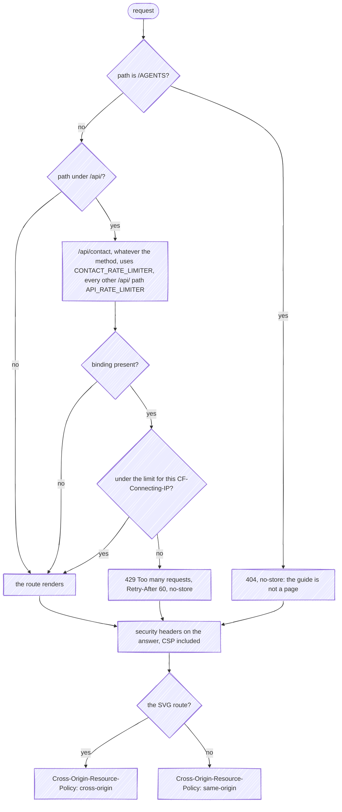
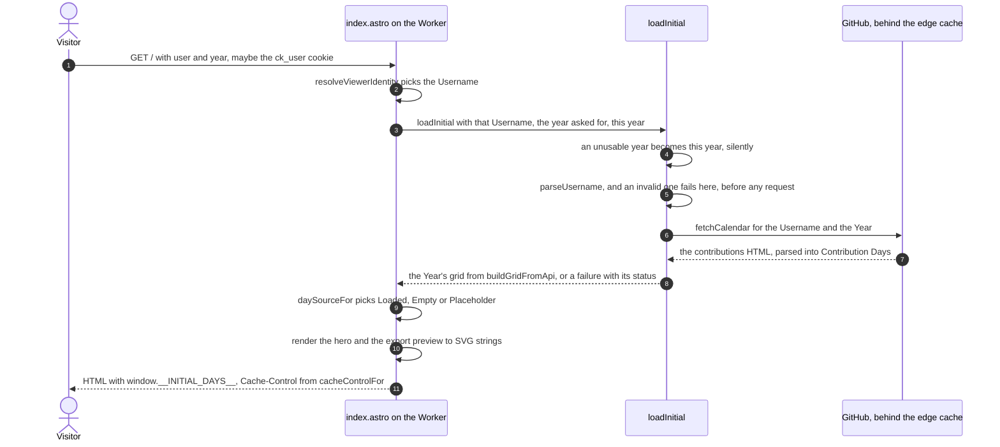
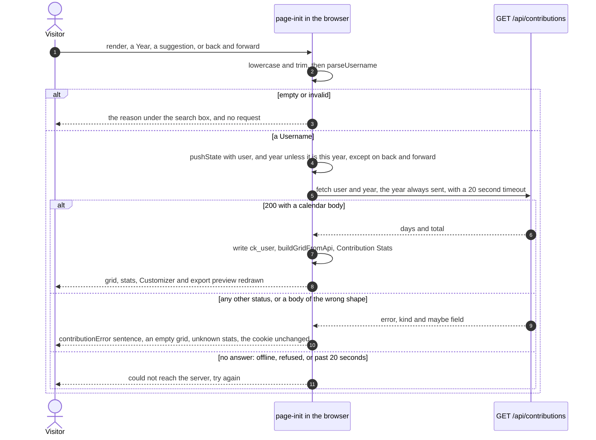
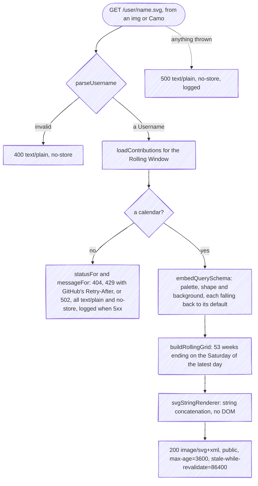
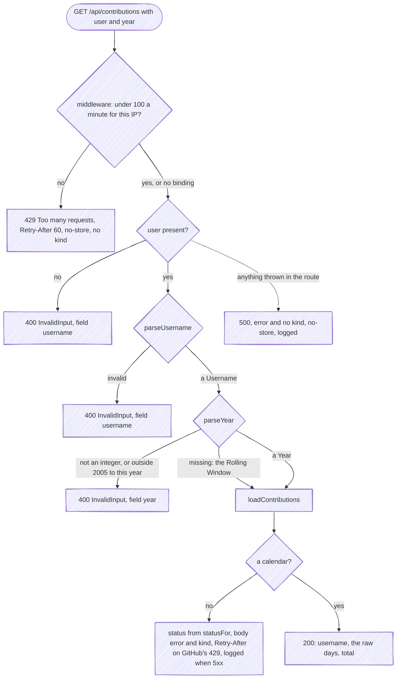
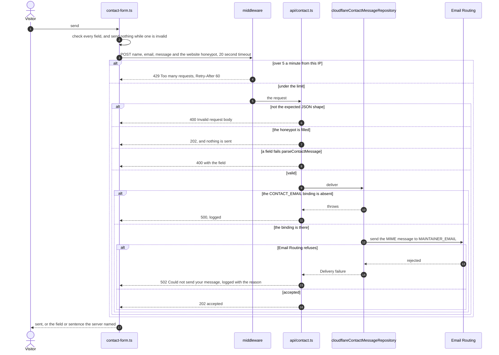
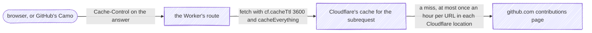

# How It Works

ContribKit never touches the GitHub API. It reads the **public** contributions page that GitHub renders at `github.com/users/{login}/contributions`, parses the Contribution Days out of the HTML, builds a calendar grid, and renders it. No token, no OAuth, no private data.

This page follows each thing the web does from the request that starts it to what the visitor sees, failures included. The app's flows are on **[Mobile App](Mobile-App)**, and the pipeline that ships both is **[CI/CD](CI-CD)**.

| Route | Started by | Answers | Grid | `Cache-Control` on success |
|-------|------------|---------|------|----------------------------|
| `GET /` | a visit, a shared link with `?user=` and `?year=` | the landing page, server-rendered, then [`page-init`](#hydrating-it-page-init) | the Year's, `buildGridFromApi` | `private`, an hour, and only when the visitor asked for someone |
| `GET /api/contributions` | a search on the landing page, or anyone's code | JSON: the raw Contribution Days and the Total Contributions | none: the client builds it | `public`, an hour, revalidated for a day |
| `GET /user/:username.svg` | an ``, a README Embed through GitHub's Camo proxy | an SVG | the Rolling Window, `buildRollingGrid` | `public`, an hour, revalidated for a day |
| `POST /api/contact` | the `/contact` form, or the app's Contact sheet | `202` and an email to the maintainer | none | `no-store`, always |
| `GET /api/health` | a person checking a deploy | which variables and bindings the Worker has, never their values | none | `no-store` |

---

## Every request: the middleware

Every request the Worker serves passes through [`middleware.ts`](https://github.com/fbuireu/contribKit/blob/main/web/src/middleware.ts) first. Static assets never do: Workers Assets answers them before the Worker runs, so `public/_headers` carries their headers.



- **Only `/api/*` is rate-limited**, per IP: 100 requests a minute on everything but the contact route, which has its own bucket of 5, because it protects a mailbox rather than an upstream. The SVG route is deliberately not limited: README Embeds reach it through GitHub's shared image proxy, so a per-IP limit would throttle every reader at once ([ADR 0010](https://github.com/fbuireu/contribKit/blob/main/docs/adr/0010-rate-limit-only-the-json-api.md)). Its throttle is the edge cache described [below](#caching-three-layers).
- **A request with no `CF-Connecting-IP`** shares one bucket, keyed `unknown`, with every other such request. **A missing binding means no limit at all**: the middleware lets the request through rather than refusing it.
- **The 429 is ContribKit's own**, and its body, `{"error":"Too many requests"}`, carries no `kind`: that is how a client tells it from a `RateLimited` that GitHub caused. It is not logged.

---

## Loading the landing page

A browser asks for `/`, perhaps with `?user=` and `?year=` from a shared link, perhaps carrying the `ck_user` cookie from an earlier search. [`index.astro`](https://github.com/fbuireu/contribKit/blob/main/web/src/pages/index.astro) renders the whole page on the Worker, calendar included, so the first paint already shows contributions and no script has to run before it does.



**Whose calendar.** `resolveViewerIdentity` takes, in order: `?user=`, trimmed and cut at 40 characters, even when it is not a valid Username, because the visitor asked for it and should be told why it failed; then the `ck_user` cookie, but only when it parses as a Username, so a stale or tampered cookie is ignored rather than reported; then the first Suggested Username, which counts as *not explicit*. **Which Year.** `?year=` when it is an integer from 2005 to this year, and this year otherwise, without an error: a bad `?year=` in a shared link still shows a calendar. There is no Rolling Window on the landing page, so the year select offers Years only.

**What the visitor sees** is one of three states, and the cache header follows them:

| Asked for someone? | GitHub answered? | State | Grid | Hero | `Cache-Control` |
|--------------------|------------------|-------|------|------|-----------------|
| yes | yes | `Loaded` | their days for the Year | their Contribution Stats | `private, max-age=3600, stale-while-revalidate=86400` |
| yes | no, or the Username was invalid | `Empty` | an empty grid for the Year | unknown stats, and the reason under the search box (*username not found, check it and try again*, *invalid username*, *too many requests, try again in a moment*…) | `private, no-store` |
| no | yes | `Loaded` | the Suggested Username's days | its Contribution Stats | `private, no-store` |
| no | no | `Placeholder` | a seeded, invented grid from `generateData` | stats of that grid, no error | `private, no-store` |

**Why `private` either way.** The page can depend on a cookie, so no shared cache may store one visitor's page for another; it is cacheable at all, for an hour in the visitor's own browser, only when the visitor named someone and the calendar loaded. A failure on `/` is logged like a route's when it is a 5xx (`endpoint: page`); a 404 or a 429 is not. Anything that throws while rendering is answered by `500.astro`.

---

## Hydrating it: `page-init`

The page's one module script calls `initPage()` in [`page-init.ts`](https://github.com/fbuireu/contribKit/blob/main/web/src/ui/utils/page-init.ts). It does not fetch: the server already drew the hero and the export preview, and it handed the same days to the browser as `window.__INITIAL_DAYS__`, so the client takes those instead of asking again.

1. **Validate the injected days.** `contributionGridSchema` checks `window.__INITIAL_DAYS__`; anything that does not match, a missing value included, is replaced by `generateData()`, the same seeded placeholder the server falls back to, so the controller never runs on a shape it cannot draw.
2. **Settle the Username.** The search box's server-rendered value becomes the current Username. When the URL named nobody, `seedUsernameCookie` writes `ck_user` only if no cookie exists yet, so a first visit remembers the Suggested Username without overwriting a returning visitor's. When the URL's `?user=` is missing or differs from what the server rendered, `history.replaceState` writes the rendered one in, so the address bar always names the calendar on screen.
3. **Wire the page.** The Customizer, the Home Screen Widget preview, the export preview, the Palette and Cell Shape radios, the export tabs, the search box, the history listener and the Cell Tooltips.

---

## Searching a Username

A search starts from the render button or the form's submit, a change of Year, a Suggested Username, or the browser's back and forward buttons. Each one ends in `renderFromGitHub`.



- **The Year is always sent**, so the client never asks the API for the Rolling Window; the URL carries `?year=` only when it is not this year, so a shared link stays short.
- **The cookie is written on success only.** A Username that 404s is never remembered for the next visit.
- **Back and forward re-run the search** from the URL's `?user=` and `?year=` without pushing a new entry; an invalid `?user=` there shows its reason and requests nothing.
- **A search is never cancelled.** The render button is disabled while a request is out, but a change of Year or a suggestion can start a second one, and whichever answers last is what the page shows.
- Each outcome records one Usage Event, `calendar_rendered` or `calendar_render_failed` with its reason, and only once the visitor has consented ([Web Application](Web-Application#usage-events)).

---

## The SVG Embed: `GET /user/:username.svg`



[`[username].svg.ts`](https://github.com/fbuireu/contribKit/blob/main/web/src/pages/user/%5Busername%5D.svg.ts) is the only route that ignores `?year=`: an Embed is pasted into a README once, so it always draws the Rolling Window, on the fixed 53-week grid. A junk `palette`, `shape` or `background` degrades to the default instead of breaking the image. Nothing about the visitor changes the answer, so it is `public`, and the Worker is not rate-limited on it: the edge cache on the GitHub request is what keeps a cache-busting caller from making GitHub throttle the Worker. Every failure is `no-store`, so a transient one is never replayed into a README through Camo.

---

## The JSON API: `GET /api/contributions`



[`contributions.ts`](https://github.com/fbuireu/contribKit/blob/main/web/src/pages/api/contributions.ts) returns the Contribution Days **as parsed**, `date`, `level` and `count`, with no grid: the landing page's client builds its own with `buildGridFromApi`, and any other caller builds whatever it needs. Every error answer is `no-store` and carries the failure's `kind`, so a client can word it without reading `error`; the two answers with no `kind` are the middleware's own 429 and the 500 an unexpected throw gets. **[API Reference](API-Reference)** has every status.

---

## The contact form: `POST /api/contact`

A Contact Message comes from the `/contact` page, through [`contact-form.ts`](https://github.com/fbuireu/contribKit/blob/main/web/src/ui/components/contact/contact-form.ts), or from the app's Contact sheet. It leaves as an email and is stored nowhere ([ADR 0030](https://github.com/fbuireu/contribKit/blob/main/docs/adr/0030-contact-messages-leave-through-cloudflares-send-email-binding.md)).



- **The missing binding is the one throw.** `cloudflareContactMessageRepository` returns a `Delivery` failure when Email Routing refuses a send, but throws when `CONTACT_EMAIL` is not bound at all, because that is a broken deployment rather than a refused message. The route's own boundary catches it, logs it and answers `500 {"error":"Something went wrong. Please try again."}`, `no-store`. `/api/health` reports whether the binding is present.
- **Nothing about the message is logged.** A 502 writes one line with the failure's kind, status and Email Routing's reason, and a 500 the thrown error; never the name, the address or the text.
- **The form tells a refusal from silence.** A 2xx clears the form and says the message is on its way; any other answer points at the field the body names, or shows its `error`, and records the Usage Event outcome `rejected`, a 502 included; a request that never answers shows *could not send your message, try again in a moment* and records `failed`.
- **Every answer is `no-store`**, the `202` included.

---

## Caching: three layers



1. **The GitHub request, at the edge.** [`github-html-contributions-repository.ts`](https://github.com/fbuireu/contribKit/blob/main/web/src/infrastructure/github/github-html-contributions-repository.ts) fetches with `cf: { cacheTtl: 3600, cacheEverything: true }`, so Cloudflare keeps GitHub's answer for an hour, keyed on the GitHub URL: the Username and the Year's date range. Every route shares it, and whatever query string the inbound request carried, a Username and Year cost GitHub at most one request an hour in each Cloudflare location that serves them. This is the SVG route's real throttle. It never shows in a response header. Which statuses it holds is Cloudflare's rule rather than this repository's: nothing here sets `cacheTtlByStatus`, so whether a 404 or a 429 GitHub sent is kept for the hour too is not something the code decides.
2. **The answer, in the reader's caches.** A calendar from the SVG or the JSON route is `public, max-age=3600, stale-while-revalidate=86400`: an hour fresh, then served stale for up to a day while it revalidates. GitHub's Camo proxy caches README images on top of that. **Every failure is `no-store`**, as is every answer of the contact and health routes, so a transient error is never stored and replayed.
3. **The landing page, in the visitor's browser alone.** `private`: an hour, revalidated for a day, when the visitor named someone and the calendar loaded, and `no-store` otherwise ([above](#loading-the-landing-page)).

---

## Step by step: from a Username to Contribution Days

1. **Validation** parses query and route params with Zod, then constructs domain value objects:
   - `parseUsername` trims input and tests it against a deliberately looser approximation of GitHub's rules: alphanumeric, hyphens allowed inside, 1–39 chars. It does **not** reject consecutive hyphens, so `a--b` passes here and 404s at GitHub. If a `Username` exists, it is valid.
   - `parseYear` accepts `null`/empty (→ the Rolling Window), rejects non-integers, and bounds the year to `2005 …` the year the route read off the clock.
   - Any invalid input becomes a typed `Failure` **before any network call**.
2. **`loadContributions({ username, year })`** reaches the repository. It is a one-line arrow over `githubHtmlContributionRepository.fetchCalendar`, bound once at the module scope of [`pages/_contributions.ts`](https://github.com/fbuireu/contribKit/blob/main/web/src/pages/_contributions.ts), so warm Worker isolates reuse it. There is no use case between the route and the repository, because the one that used to sit there was `repository => params => repository.fetchCalendar(params)` and asserted only that JavaScript forwards arguments.
3. **Fetching** requests the public contributions HTML from GitHub with browser-like headers and a 20 second timeout. See **[Fetching Contributions](Fetching-Contributions)**.
4. **Parsing** extracts each day's `date`, `level` (0–4, run through `clampLevel` as the Contribution Day is built), and exact `count` (from the linked `<tool-tip>`) via regex over the HTML. See **[HTML Parsing](HTML-Parsing)**.
5. **Grid building** happens where a grid is drawn: `buildGridFromApi` lays a Year over its 53 or 54 Sunday-aligned weeks for the landing page, and `buildRollingGrid` lays the Rolling Window over a fixed 53×7 (371-cell) grid for the SVG route. The JSON route builds none. See **[Calendar Grid](Calendar-Grid)**.
6. **Rendering** turns a grid into an SVG string using the selected palette, shape, and background: on the Worker for the SVG route and the landing page's first paint, and in the browser after a search. See **[SVG Rendering](SVG-Rendering)**.

---

## Errors are values, with one exception

Every function on a request's path that can fail returns `T | Failure` rather than throwing. A `Failure` is a typed discriminated union created by small constructors (`notFound`, `invalidInput`, `network`, `upstream`, `parse`, `rateLimited`, `delivery`) and narrowed with the `isFailure` guard:

```ts
type Failure =
  | { kind: "NotFound"; username: Username }
  | { kind: "InvalidInput"; field: "username" | "year" | "color" | "date" | "name" | "email" | "message"; message: string }
  | { kind: "Network"; message: string }
  | { kind: "Upstream"; message: string }
  | { kind: "Parse"; message: string }
  | { kind: "RateLimited"; message: string; retryAfterSeconds: number | null }
  | { kind: "Delivery"; message: string };
```

`username` is the `Username` value object, not a string, and every field is `readonly` in the source, [`domain/failures/failure.ts`](https://github.com/fbuireu/contribKit/blob/main/web/src/domain/failures/failure.ts).

**The exception** is a deployment fault, not a request's: the contact repository throws when the `CONTACT_EMAIL` binding is absent. Each route also wraps its handler in a boundary that catches anything thrown, logs it and answers a `no-store` 500 in the route's own content type, and the landing page renders `500.astro` for the same reason.

At the HTTP boundary, `statusFor` and `messageFor` (in [`application/http/failure-http.ts`](https://github.com/fbuireu/contribKit/blob/main/web/src/application/http/failure-http.ts)) map a `Failure` to a status code and a user-facing message, and `errorBodyFor` builds the JSON error body from them: the message as `error`, the failure's `kind`, and the `field` of an `InvalidInput`. This is the **only** place that mapping lives:

| Failure | Typical cause | `statusFor` | `messageFor` |
|---------|---------------|-------------|--------------|
| `InvalidInput` | malformed username or year | `400` | the failure's `message` |
| `NotFound` | GitHub returned 404 for the user | `404` | `"User not found"` |
| `Network` | GitHub unreachable or too slow | `502` | `"Could not reach GitHub"` |
| `Upstream` | GitHub answered with a status other than 200, 404 and 429 | `502` | the failure's `message` |
| `Parse` | HTML structure changed, no Contribution Days found | `502` | the failure's `message` |
| `RateLimited` | GitHub answered `429` | `429` | the failure's `message` |
| `Delivery` | Email Routing refused a Contact Message | `502` | `"Could not send your message"` |

A `RateLimited` also emits a `Retry-After`, through `retryAfterHeader`: the figure GitHub named, in whichever of the two RFC forms it used, and no header at all when it named none.

**Only a status of 500 or above is logged**, through Cloudflare's export to Better Stack, with the username, failure `kind`, reason, status, and endpoint (`api`, `svg` or `page`; the landing page logs its own 5xx too). A 400, a 404 and a 429, GitHub's included, are not logged.

---

## See also

- **[Architecture](Architecture)** describes the layers behind these flows.
- **[API Reference](API-Reference)** lists every endpoint, parameter and status.
- **[Mobile App](Mobile-App)** follows the app's own fetch, cache, refresh and Home Screen Widget.
