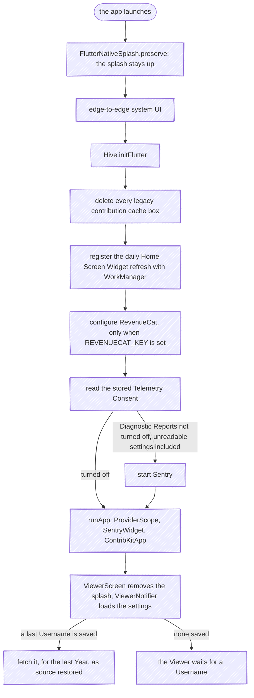
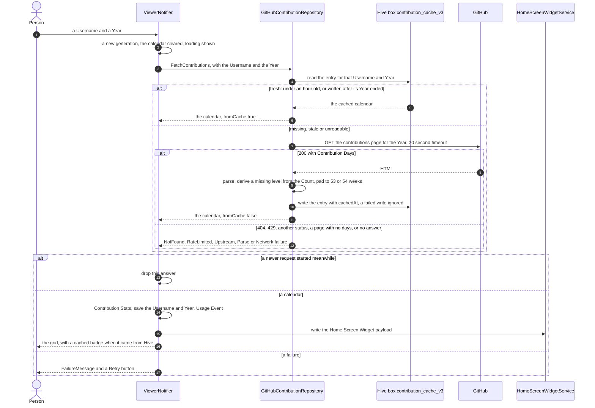
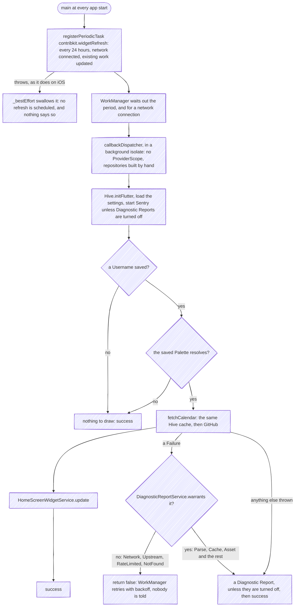
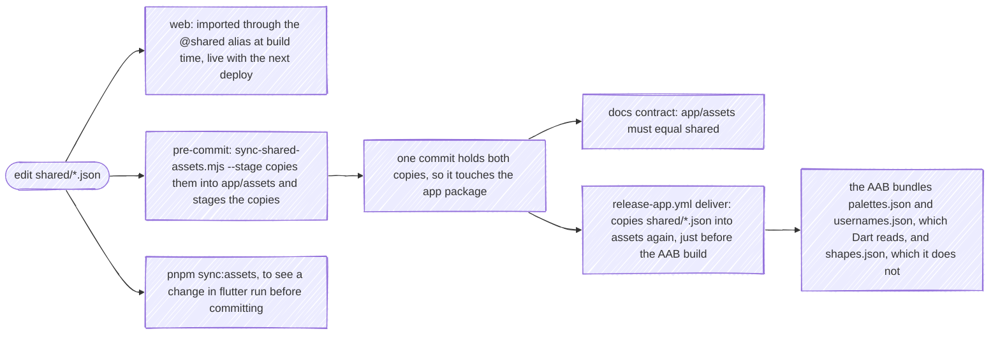

# Mobile App

The mobile component (`app/`) is a single Flutter codebase. **Only the Android app is released**, on Google Play, with Home Screen Widgets; the same code builds for iOS, but nothing builds or ships it yet, and an iOS build would have no Home Screen Widget and no background refresh. State is managed with Riverpod; Tips go through RevenueCat.

- **Google Play:** [com.fbuireu.contribkit](https://play.google.com/store/apps/details?id=com.fbuireu.contribkit)
- **App Store:** coming soon

---

## Features

- **Android, from one Flutter codebase that also builds for iOS**: only Android is released, and the Home Screen Widgets and their background refresh are Android-only, as [`app/ios`](https://github.com/fbuireu/contribKit/tree/main/app/ios) carries no WidgetKit extension and no background-task setup
- **Every palette and shape:** the palettes are the web's own design tokens, mirrored from [`shared/palettes.json`](https://github.com/fbuireu/contribKit/blob/main/shared/palettes.json). **The shapes are not**: `CellShape` is a hardcoded Dart enum, and [`shapes.json`](https://github.com/fbuireu/contribKit/blob/main/shared/shapes.json) is bundled but has no Dart reader ([ADR 0002](https://github.com/fbuireu/contribKit/blob/main/docs/adr/0002-shared-design-tokens-mirrored-into-the-flutter-bundle.md))
- **Home-screen widgets (Android):** small (streak counter) and medium (grid, streak and total)
- **Daily background refresh (Android):** WorkManager fetches once a day when there is a network, easy on the battery; the Viewer also rewrites the Home Screen Widget after every fetch and every Palette or Cell Shape change
- **Export & share:** PNG, SVG, or Markdown straight into the system share sheet
- **No login:** just a username, only public contribution data
- **Contact the maintainer** from inside the app, without a mail client or an account

---

## Architecture

Same DDD-ish layers as the web (see **[Architecture](Architecture)**):

```
app/lib/
├── domain/          entities, value objects, repository interfaces, services, failures
├── application/     use cases: fetch_contributions, invalidate_contribution_cache, export_calendar, fetch_tip_products, give_tip, send_contact_message
├── infrastructure/  github repo, asset repos, export (png/svg/markdown), persistence, tip, contact, telemetry, http
└── ui/              features (viewer, customizer, export, tip, contact, privacy, home_screen_widget), widgets, theme, DI (Riverpod)
```

The customizer offers palette, shape, **size** and background pickers: **Cell Size is app-only**, the web has no user-facing size at all ([ADR 0016](https://github.com/fbuireu/contribKit/blob/main/docs/adr/0016-cell-size-is-a-named-choice-in-the-app-and-fixed-geometry-on-the-web.md)). Each of them goes through one `SettingPicker` (`palette_picker`, `shape_picker`, `size_picker`, `background_picker`). The viewer renders the contribution grid with a stats panel. State is held in `viewer_notifier` (Riverpod) over an immutable `viewer_state` (freezed).

### Contribution stats

`ContributionStatsService.compute(calendar)` derives a `ContributionStats` value object from the calendar, all pure, no I/O:

| Stat | How it's computed |
|------|-------------------|
| `currentStreak` / `longestStreak` | consecutive **active** days: `level != none`, never `count > 0`, so a day GitHub coloured but whose Count did not parse keeps the run alive |
| `bestDayCount` / `bestDayDate` | the single highest-Count day: **both `null` together** whenever any active day has an unknown Count, because the highest Count *seen* is only a lower bound |
| `totalDaysActive` | active days, on the same Contribution Level rule |
| `weeklyAverage` | `totalContributions / weekCount`, and `null` whenever the total is |
| `bestMonthContributions` / `bestMonth` | month with the highest summed Count, `null` on the same unknown-Count rule |

Every figure derived from Counts is nullable, and `null` means *not knowable* rather than zero
([ADR 0019](https://github.com/fbuireu/contribKit/blob/main/docs/adr/0019-an-unknown-count-is-null-in-both-clients.md)). Only the two streaks and
`totalDaysActive` stay non-nullable: they count days, which the Contribution Level answers alone. `bestMonth` names
a month by summed Count, so it is nulled by the same rule as everything else derived from one.
**Six of the eight are computed and rendered nowhere**: `StatsPanel` shows the two streaks and the calendar's own
total.

### Export

Three repositories implement the `ExportRepository` interface, each producing a different artifact for the system share sheet:

| Repository | Output |
|------------|--------|
| `png_export_repository_impl` | PNG raster |
| `svg_export_repository_impl` | SVG vector |
| `markdown_export_repository_impl` | Markdown embed snippet |

### State & dependency injection

[Riverpod](https://riverpod.dev) is the app's **DI container and reactive state layer**. It lives inside `ui/`, plus the `ProviderScope` that `main.dart` mounts, so no other layer knows it exists. It does not replace the DDD layering; it's the mechanism that wires that layering together and exposes it to widgets.

**Composition root.** [`ui/di/providers.dart`](https://github.com/fbuireu/contribKit/blob/main/app/lib/ui/di/providers.dart) (code-generated [`providers.g.dart`](https://github.com/fbuireu/contribKit/blob/main/app/lib/ui/di/providers.g.dart)) is the single place allowed to import `infrastructure/` and `application/` at the same time. It instantiates the concrete repositories (GitHub, assets, settings, tip, export), passes them into the use-case classes, and exposes each as an `@riverpod` provider:

```dart
@riverpod
ContributionRepository contributionRepository(Ref ref) =>
    GitHubContributionRepository();

@riverpod
FetchContributions fetchContributions(Ref ref) =>
    FetchContributions(repository: ref.watch(contributionRepositoryProvider));
```

The chain is **repository → use case → notifier**, the same inward dependency direction as the web: widgets depend on notifiers, notifiers depend on use cases and on the repository ports `ui/di/` provides, and use cases depend on domain interfaces. Nothing flows outward.

**State.** Stateful screens use `@riverpod` notifier classes over immutable freezed state, e.g. `ViewerNotifier` holds `ViewerState`, mutating only via `state = state.copyWith(...)`. Widgets stay dumb: `ref.watch` to read state, `ref.read(provider.notifier).method()` to act (no business logic in `build`). Persisted settings (username, palette, shape, size, background, theme) live behind `settings_repository_impl` (local persistence) and are read/written by notifiers through the repository, never directly.

### Why Riverpod

| Reason | What it buys |
|--------|-----------------|
| **Compile-time DI** | Providers are generated and statically typed: no runtime service locator, no `GetIt`-style string/type registry that can fail at runtime. |
| **Enforces the dependency direction** | The composition root is the *only* file that touches both `infrastructure/` and `application/`. Everywhere else consumes providers, so the inward-pointing layering can't be accidentally violated. |
| **No global singletons** | Repositories and use cases are scoped to the `ProviderContainer`, not module-level globals, so lifecycle and disposal are explicit. |
| **Reactive by default** | `ref.watch` rebuilds dependents automatically; derived providers (e.g. `palettes` watching `paletteRepository`) recompute when their inputs change. |
| **Testable** | Any provider can be swapped with `overrideWith` in tests, so notifiers run against fake repositories with no Flutter or network involved, matching the web's "domain knows nothing" testing story. |
| **Code generation** | `@riverpod` removes the boilerplate of hand-written `Provider`/`StateNotifierProvider` declarations and keeps provider names/types in sync. |

---

## How the app works

### Starting the app

`main()` in [`main.dart`](https://github.com/fbuireu/contribKit/blob/main/app/lib/main.dart) keeps the native splash up while it prepares, then hands over to the Viewer, which removes the splash as soon as its screen first builds.



Edge-to-edge, the legacy-box deletion, the WorkManager registration, RevenueCat and Sentry's start each run through `_bestEffort`, which swallows what they throw: a store that will not configure, a cache box that will not delete or a WorkManager that refuses the task never keeps the app from opening. The cost is that those failures are silent. Diagnostic Reports are on until a person turns them off, and settings that cannot be read count as never asked, so Sentry starts then too; Usage Events wait for a yes ([ADR 0028](https://github.com/fbuireu/contribKit/blob/main/docs/adr/0028-telemetry-consent-is-asked-twice-and-answered-asymmetrically.md)).

### Opening a calendar

Typing a Username, picking a Year or a Suggested Username, the Retry button and the restore at start-up all end in `ViewerNotifier.fetchContributions`. The app asks GitHub itself, never ContribKit's API ([ADR 0011](https://github.com/fbuireu/contribKit/blob/main/docs/adr/0011-keep-the-apps-own-scraper-for-now.md)), and keeps what it gets in Hive.



The cache entry is keyed by the lowercased Username and the Year, and stamped with the instant it was written:

| Entry | Fresh for | Then |
|-------|-----------|------|
| written while its Year was still under way | one hour | fetched again from GitHub |
| written after its Year ended | ever | never fetched again on its own: a finished Year cannot change. Refresh clears it, and so does a new box name ([ADR 0014](https://github.com/fbuireu/contribKit/blob/main/docs/adr/0014-cached-calendars-are-versioned.md)) |
| unreadable: corrupt, or a shape the code no longer reads | never | treated as absent, and fetched |

**There is no stale fallback.** A stale entry is not shown when GitHub cannot be reached: offline, the Viewer shows a fresh entry or a finished Year it already has, and for anything else *Could not reach the server* and a Retry button, though the stale entry is still on disk. **A newer request wins**: each fetch takes a generation number, and an answer that arrives after a newer fetch started is dropped, so picking Years quickly never paints an older one last.

### Refreshing

The refresh button beside the calendar runs `refreshContributions`. It first runs `InvalidateContributionCache`, which deletes **every cached Year for that Username**, not just the one on screen, then fetches the Year on screen, as `source: refresh`. A `CacheFailure` while deleting is reported as a Diagnostic Report and the fetch goes ahead anyway, so a cache that cannot be cleared never stops fresh data arriving.

**Offline, a refresh loses data.** The entries are deleted before the request that would replace them, so a refresh with no network clears every Year of that Username, finished ones included, and then fails with *Could not reach the server*; switching to another Year fails the same way until the network is back.

### Keeping the Home Screen Widget current

Two writers keep the Android Home Screen Widgets current, and both hand `HomeScreenWidgetService.update` the same payload: the Contribution Levels, the week count, the Palette's colours, the Cell Shape, the Username, the Streak and the Total Contributions. `update` saves them through `home_widget` and asks both Android providers to redraw, and swallows anything that fails.

- **In the foreground**, `ViewerNotifier` writes after every calendar it shows and after every Palette or Cell Shape change, so the widget matches the Viewer. A Cell Size or a Background Preset changes nothing on it, so it does not write then.
- **In the background**, WorkManager runs a periodic task once a day:



The isolate builds `GitHubContributionRepository`, `HiveSettingsRepository` and `AssetPaletteRepository` by hand and runs `HomeScreenWidgetRefresh`, the class the tests exercise, and it closes the HTTP client and Hive whatever happened. It reads the same Hive cache as the Viewer, so a refresh within an hour of a foreground fetch, or of a finished Year, costs no request. A failure that is the world's doing, no network, a rate limit, a renamed account, is answered with a retry and reported to nobody; one that is a defect becomes a Diagnostic Report, and is then marked done so it does not retry into the same defect.

**Why there is none on iOS.** `app/ios` has no WidgetKit extension, so there is no iOS widget to update, and `updateWidget` names only the two Android providers. iOS's `workmanager` needs the task's identifier declared under `BGTaskSchedulerPermittedIdentifiers` in `Info.plist` and registered in `AppDelegate.swift`, and neither is there, so the registration cannot succeed and `_bestEffort` hides the error. A widget on iOS would need all three.

---

## Home-screen widgets

Android only: there is no iOS widget.

| Size | Provider | Shows |
|------|----------|-------|
| Small (80×40dp) | `ContribKitSmallWidgetProvider` | Streak counter |
| Medium (250×110dp) | `ContribKitWidgetProvider` | Username, streak badge, grid image and year total |

Widgets are driven by [`home_screen_widget_service.dart`](https://github.com/fbuireu/contribKit/blob/main/app/lib/ui/features/home_screen_widget/home_screen_widget_service.dart): the Viewer rewrites them after every fetch and every Palette or Cell Shape change, and WorkManager refreshes them once a day in the background ([above](#keeping-the-home-screen-widget-current)).

---

> **Markdown export is an Embed, not a file.** It emits ``, the same
> snippet the web builds. It used to embed the SVG as a base64 `data:` URI, which GitHub does not render in
> Markdown, so the one surface the tile is labelled for ("README embed snippet") was the one it could not work on.

## Tips

ContribKit offers an optional **Tip Jar** via RevenueCat ([`revenuecat_tip_repository.dart`](https://github.com/fbuireu/contribKit/blob/main/app/lib/infrastructure/tip/revenuecat_tip_repository.dart)), surfaced in [`ui/features/tip/tip_jar_sheet.dart`](https://github.com/fbuireu/contribKit/blob/main/app/lib/ui/features/tip/tip_jar_sheet.dart). The use cases are `fetch_tip_products` (loads the available `TipProduct`s) and `give_tip`, which returns a `TipOutcome` so backing out of the store sheet is not reported as a failure. A Tip unlocks nothing and no code may check whether one was given ([ADR 0009](https://github.com/fbuireu/contribKit/blob/main/docs/adr/0009-tips-are-unconditional-and-unlock-nothing.md)). The glossary reserves **Tip** for this and lists "purchase" under `_Avoid_`, which is why none of these names says it. The default `dart-defines.json` carries the RevenueCat sandbox key; `dart-defines.prod.json` carries the production one.

## Contact

The Viewer header carries a mail button that opens a **Contact** sheet: a name (optional), an email address and a message. Sending it is the **only** request the app makes to a ContribKit server, and the only thing you type that leaves the device. Everything else the app fetches comes straight from GitHub.

The message is posted to [`POST /api/contact`](API-Reference) on `contribkit.app`, which turns it into an email and hands it to Cloudflare Email Routing. **Nothing is stored on the server**: no database row, and no copy beyond the email itself. A send Email Routing refuses writes one log line with the failure's kind and the platform's reason, never the name, the address or the text ([ADR 0030](https://github.com/fbuireu/contribKit/blob/main/docs/adr/0030-contact-messages-leave-through-cloudflares-send-email-binding.md)).

`ContactMessage` validates before anything is sent, so a bad address or a message under ten characters is refused on the device rather than by the server. Its length limits are the same numbers the web's own value object declares, and the documentation-consistency test diffs the two.

The endpoint has a limit of its own, five messages a minute per address, and a send over it is answered `429` with `Retry-After: 60`. The sheet words that as *Too many messages sent. Try again after 14:32.*, through `FailureMessage.ofContact`: the request never reached GitHub, so it does not say GitHub's rate limit was hit, which is what the Viewer says for a `429` from GitHub.

Opening the sheet records `UsageEvent.contactOpened`, and sending records `contactMessageSent` with an outcome of `sent` or `failed`: a name from a fixed list and an outcome from another, so no part of the message is ever Telemetry. The Privacy sheet names this sheet as the one exception to "ContribKit never sends anything you type".

## Usage Events

Usage Events are off until a person turns them on in the Privacy sheet ([ADR 0028](https://github.com/fbuireu/contribKit/blob/main/docs/adr/0028-telemetry-consent-is-asked-twice-and-answered-asymmetrically.md)). Each one is a name from this list plus the properties beside it, every one drawn from a closed set: an enum's name, a Palette key, a store product id, a Year, a boolean. `UsageEvent` in `domain/value_objects/` has one constructor per row and none of them takes a string, which is what keeps the username, anything typed and the calendar out ([ADR 0027](https://github.com/fbuireu/contribKit/blob/main/docs/adr/0027-the-app-sends-telemetry-through-two-ports-with-no-failure-channel.md)).

| Event | Properties | Recorded when |
|-------|------------|---------------|
| `calendarViewed` | `year`, `source` (`restored` / `typed` / `suggestion` / `year` / `refresh` / `retry`), `fromCache` | a Contribution Calendar arrives in the Viewer |
| `calendarRequestFailed` | `source`, `reason` (`network` / `notFound` / `rateLimited` / `parse` / `cache` / `unexpected`) | a request for one fails |
| `yearChosen` | `year` | a Year pill is tapped |
| `customizerOpened` | none | the Customizer sheet opens |
| `paletteChosen` | `palette` (the Palette key) | a Palette is picked |
| `cellShapeChosen` | `cellShape` | a Cell Shape is picked |
| `cellSizeChosen` | `cellSize` | a Cell Size is picked |
| `backgroundChosen` | `background` (the Background Preset) | a Background Preset is picked |
| `exportOpened` | none | the Export sheet opens |
| `exportShared` | `format` (`png` / `svg` / `markdown`), `delivery` (`share` / `clipboard`) | an Export reaches the clipboard, or leaves through the share sheet; a dismissed sheet records nothing |
| `exportFailed` | `format` | an Export fails to render or to deliver |
| `tipJarOpened` | none | the Tip Jar opens |
| `tipGiven` · `tipCancelled` · `tipFailed` | `product` (the store's Tip Product id) | the store answers a Tip; declared on Google Play as purchase history ([ADR 0028](https://github.com/fbuireu/contribKit/blob/main/docs/adr/0028-telemetry-consent-is-asked-twice-and-answered-asymmetrically.md)) |
| `contactOpened` | none | the Contact sheet opens |
| `contactMessageSent` | `outcome` (`sent` / `failed`) | a Contact Message is sent or refused |
| `privacyOpened` | none | the Privacy sheet opens |
| `themeChanged` | `mode` (`light` / `dark`) | the theme toggle is tapped |

## Development

The app is the `app/` package in the pnpm workspace, but built with Flutter:

```bash
cd app
flutter pub get
flutter run --dart-define-from-file=dart-defines.json
```

Build-time config is supplied via `dart-defines.json` (dev) and `dart-defines.prod.json` (prod). Both are gitignored, so create them yourself: a JSON object with the keys in the table under [Releases](#releases). Every value may be empty, and an empty one only turns its feature off: no Tip Jar without `REVENUECAT_KEY`, no Diagnostic Report without `SENTRY_DSN`, no Usage Event without `POSTHOG_PROJECT_TOKEN`. The two files differ by the RevenueCat key, the sandbox one in `dart-defines.json` and production's in `dart-defines.prod.json`, and by `TELEMETRY_ENVIRONMENT`, `production` in the second ([ADR 0022](https://github.com/fbuireu/contribKit/blob/main/docs/adr/0022-the-app-has-no-build-flavors-and-the-stage-is-a-dart-defines-file.md)). [`app/README.md`](https://github.com/fbuireu/contribKit/blob/main/app/README.md#development) has a file to start from. Design tokens come from `app/assets/*.json`, regenerated from `shared/` with `pnpm sync:assets`. See **[Project Structure](Project-Structure)** and **[Git Hooks](Git-Hooks)**.

---

## Shared design tokens



The app uses generated copies in `app/assets/*.json`. See **[shared/](https://github.com/fbuireu/contribKit/blob/main/shared/README.md)** and [ADR 0002](https://github.com/fbuireu/contribKit/blob/main/docs/adr/0002-shared-design-tokens-mirrored-into-the-flutter-bundle.md) for why. Always edit `shared/*.json` and run `pnpm sync:assets` (or rely on the lefthook pre-commit hook, which does it when you stage the change), and never edit [`app/assets/`](https://github.com/fbuireu/contribKit/tree/main/app/assets) by hand. Note that this moves **palettes and suggested usernames only**: nothing in Dart reads `shapes.json`, so adding a shape there changes the web and does nothing here. [`release-app.yml`](https://github.com/fbuireu/contribKit/blob/main/.github/workflows/release-app.yml) re-copies them before building the AAB, but `_ci-app.yml` does not, so a stale mirror reaches CI unnoticed except through the docs-consistency test. See **[Project Structure](Project-Structure)**.

---

## Releases

Built and **shipped to Google Play** by `release-app.yml`, on a manual dispatch from `main` that picks a track (`internal` / `alpha` / `beta` / `production`). **Only Android is released**: the fastlane lane is `platform :android`, no workflow builds iOS, and the App Store listing is "coming soon".

The run is sequential, and nothing in it is left to a person once it starts:

1. **Version.** semantic-release reads the commits since the last `app-v*` tag, bumps `pubspec.yaml`, writes `CHANGELOG.md`, commits, tags `app-vX.Y.Z` and publishes the GitHub release. With nothing to release it stops there, and so does the run.
2. **Deliver from the tag.** A second job checks out that tag, never `main`, decodes the upload keystore and the Play service account from the GitHub Environment the track chose, and copies `shared/*.json` into `assets/`.
3. **Build.** It writes `dart-defines.json` with the five keys listed below and builds the App Bundle with `--obfuscate --split-debug-info=build/symbols`; R8 shrinks the Java/Kotlin side.
4. **Symbols.** It uploads the debug symbols to Sentry, and **fails when `SENTRY_AUTH_TOKEN` is empty**: an obfuscated build without its symbols would make every Diagnostic Report unreadable.
5. **Notes and upload.** It turns the newest `CHANGELOG.md` section into the Play release notes, then `fastlane deploy` uploads the AAB to the track, with up to three attempts. Every track is uploaded with `release_status: "completed"`, so **a production release reaches 100% of devices at once**.
6. **Clean up.** Whatever happened, the keystore, the signing config, the service account and `dart-defines.json` are deleted when the job ends.

The `track` input picks the GitHub Environment, and its secrets fill the `dart-defines.json` CI writes before building. Neither of the two local files, `dart-defines.json` and `dart-defines.prod.json`, is committed: [`app/.gitignore`](https://github.com/fbuireu/contribKit/blob/main/app/.gitignore) lists `dart-defines*.json` under its secrets heading. CI never reads them either: the `deliver` job writes a `dart-defines.json` of its own, with these keys, and passes it to `--dart-define-from-file`:

| Key | In CI | What reads it |
|-----|-------|---------------|
| `REVENUECAT_KEY` | the Environment's secret: production's key, or the RevenueCat sandbox's | the Tip Jar; empty, it renders as unavailable |
| `SENTRY_DSN` | the Environment's secret | Diagnostic Reports; empty, none is sent |
| `POSTHOG_PROJECT_TOKEN` | the Environment's secret | Usage Events; empty, none is sent |
| `TELEMETRY_ENVIRONMENT` | `production` for the production track, `development` otherwise | the environment Sentry files a Diagnostic Report under; `development` when absent |
| `APP_RELEASE` | `contribkit@<version>` | the release Sentry files a report under, which is how it finds the uploaded symbols |
| `POSTHOG_HOST` | not written | the PostHog host; absent, the EU one |

| `track` input | GitHub Environment | Target |
|---------------|--------------------|--------|
| `production` | `app-production` | Play production track |
| anything else | `app-development` | Chosen Play track + RevenueCat sandbox |

**When `deliver` fails**, the tag and the GitHub release already exist and nothing reached Play, so a new dispatch finds nothing to release. Fix the cause and re-run the failed job on the same run. **[CI/CD](CI-CD)** has the full delivery flow, every secret it reads, and that recovery in detail.
